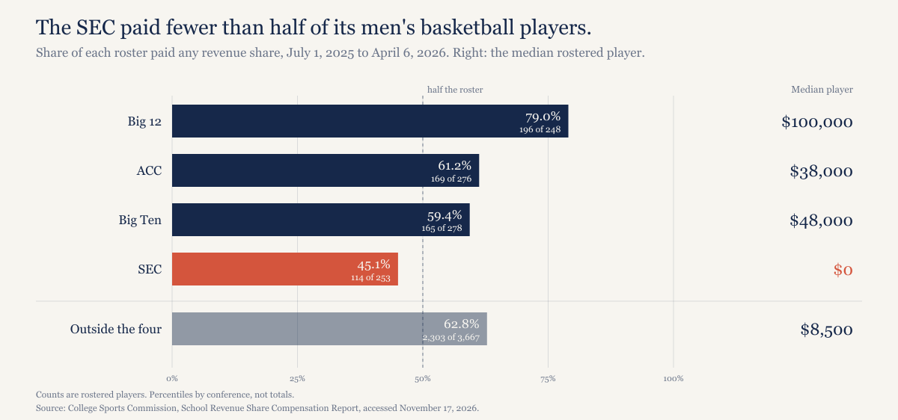
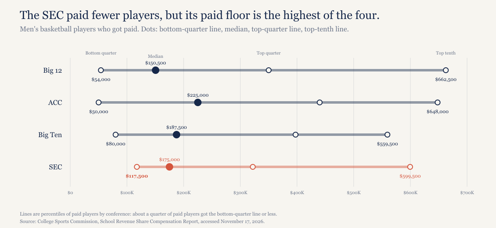

# More than half the SEC's men's basketball players had no revenue-share payment by April 6. In the Big 12, the median player got $100,000.

*Every school worked under the same $20.5 million cap. The four power conferences split basketball money in very different ways.*

---

## The data

The College Sports Commission runs CAPS, the College Athlete Payment System, where schools record the revenue-share payments they make to athletes. Its School Revenue Share Compensation Report breaks those payments out by sport and conference, which is more than any school has volunteered. Illinois [denied my records request](https://ledgerandwhistle.substack.com/p/no-big-ten-school-has-published-revenue) for what it paid athletes by sport, and I couldn't find a Big Ten school that publishes the number in dollars.

What the report gives is percentiles, not totals. For men's basketball it covers payments made from July 1, 2025 to April 6, 2026; anything due after April 6 isn't in it. Each conference gets two cohorts: one with every rostered player, including the ones paid nothing, and one with only the players who got paid. Divide the second count by the first and you get the share of a roster that saw any money at all. The tables stop at the conference, so no single school shows up. Each of those schools worked under a $20.5 million revenue-share cap for 2025-26, Ministry of Sport reported when the CSC released its data, and the report doesn't say how any of them divided it between sports.

## Who got paid in men's basketball

The Big 12 paid 79.0% of its men's basketball players, 196 of 248. The ACC paid 61.2% (169 of 276) and the Big Ten 59.4% (165 of 278). The SEC paid 45.1%, 114 of 253, so more than half the league's rostered players had no revenue-share payment recorded by April 6.

The medians fall out of that. The median rostered Big 12 player got $100,000, the Big Ten's got $48,000 and the ACC's $38,000. In the SEC, where fewer than half were paid, the middle of the roster lands on a zero: $0 for the median player.

That doesn't make the SEC stingy with the players it does pay. Count only players who got money and the SEC has the highest floor of the four: roughly three in four paid SEC players got at least $117,500, against $80,000 in the Big Ten, $54,000 in the Big 12 and $50,000 in the ACC. Its paid median is $175,000. The Big 12 went the other way, spreading money across most of its roster at a paid median of $150,500, the lowest of the four.

Where the SEC trails is the top of the full roster. The line a player had to clear to be in the top tenth was $579,000 in the Big 12, $500,500 in the ACC and $462,500 in the Big Ten. In the SEC it was $339,500. Some of that is arithmetic: with fewer than half its roster paid, the top tenth of the SEC's full roster reaches further down into the players it did pay. Among paid players alone, the SEC's top-tenth line is $599,500, ahead of the Big Ten's $559,500.

*[Caption: figures/captions.md, fig-01-share-paid]*

One more thing the counts show. Across the four power conferences, 61.0% of men's basketball players got paid, 644 of 1,055. Outside them it was 62.8%, 2,303 of 3,667, so a player in a smaller conference was a little more likely to get something. The amounts aren't close, though: the median paid player outside the four got $33,000.

*[Caption: figures/captions.md, fig-02-paid-range]*

## Football runs on a different clock

Power-conference football paid, or scheduled payments to, 75.1% of its rostered players in 2026, 5,817 of 7,743 across positions. At quarterback, the line for the top tenth was $1,266,500, 2.2 times the highest basketball figure above, the Big 12's $579,000.

Those windows don't match, and it matters. Football counts payments made or scheduled in calendar 2026, and the CSC says that during the season CAPS treats virtually all contingent performance incentives as scheduled payments, so a bonus a player may never earn still counts. Basketball counts payments made through April 6. That's why I'm comparing shares and percentiles here and not adding anything up.

My read is the SEC's basketball numbers look like a football-first league spending its cap where its money comes from. The data doesn't show school budgets, so it can't prove that; the pattern just fits it.

## Women's basketball

The women's side has its own outlier, and it's the Big Ten, which paid 79.4% of its women's players, 200 of 252, with a median rostered player at $31,000. Its paid median, $50,000, was the highest of the four, too. The SEC paid 46.0% (98 of 213), the smallest share of the four again, and its median rostered player got $0.

## What this can't tell you

No totals, and no schools. Percentiles by conference can't be turned into what any one program spent, and adding them across conferences produces nothing that means anything. Payments due after April 6 are missing, so an SEC school that pays late in the year would look smaller here than it is. The report also leaves out scholarships, cost-of-attendance stipends and Alston payments, and third-party NIL deals sit in a separate NIL Go report.

## What I expect

When the CSC publishes 2026-27 basketball numbers, the SEC is again the power conference that pays the smallest share of its men's basketball roster. 

## About this piece

*Construction note. The data comes from the College Sports Commission's School Revenue Share Compensation Report, scraped from its interactive tables on November 17, 2026 into data/csc-revshare.csv. Every figure is a conference-level percentile, and the CSC suppresses a percentile when a cohort is too small: 100 athletes for the top and bottom tenth, 40 for the quarters, 10 for the median. The share paid is the "Without $0" cohort divided by the "With $0" cohort. Basketball covers payments made from July 1, 2025 to April 6, 2026; football covers payments made or scheduled in calendar 2026. Every number is recomputed from the data files by model/recompute.py. Not legal or financial advice.*

*Disclosure: I'm an Illinois basketball and football fan, not an alum.*

## Sources

- College Sports Commission, [School Revenue Share Compensation Report](https://www.collegesportscommission.org/school-revenue-share-compensation-report/), accessed November 17, 2026
- College Sports Commission, [Compensation Reports](https://www.collegesportscommission.org/compensation-reports/), accessed November 17, 2026
- Ministry of Sport, [College Sports Commission Releases Historic Student-Athlete Compensation Data Following House Settlement](https://ministryofsport.com/college-sports-commission-releases-historic-student-athlete-compensation-data-following-house-settlement/), November 1, 2026
- Ledger & Whistle, [No Big Ten school has published revenue sharing by sport in dollars. Illinois is the one that posts the form built to show it.](https://ledgerandwhistle.substack.com/p/no-big-ten-school-has-published-revenue), October 14, 2026
- Data and checking script: [cbb-revenue-share-2026 on GitHub](https://github.com/mgag70-prog/hqsports-research/tree/main/cbb-revenue-share-2026)

---

## Not for publication

Alternate titles:

1. The SEC's median men's basketball player got $0 in revenue share. The Big 12's got $100,000.
2. Same $20.5 million cap, four answers to who in basketball gets paid.

Cover line (verbatim in "Who got paid in men's basketball"): $0 for the median player.

Open items:

- H1 changed from the outline's "got no revenue share last season" to "had no revenue-share payment by April 6": the basketball window stops there, and payments due after it aren't counted, so "last season" overstates what the data shows.
- Percentiles are written without ordinals: "the top tenth" for the p90 column, "roughly three in four paid players got at least" for the paid p25 column, which follows the CSC's own definition ("at or below which approximately 90% ... fall").
- Ministry of Sport date: the page's published time is 22:17 UTC November 1 (evening of November 1 Eastern). context.csv says November 2; Sources says November 1.
- September 30: the report's football tables are headed "Payments in calendar year 2026 · agreements as of September 30, 2026" (context.csv fb_window copies that), while the compensation-reports page gives September 30 as the cutoff for third-party NIL deals in the football data. The draft uses "made or scheduled in calendar 2026" and leaves the September 30 date out.
- Ministry of Sport's $1.77 billion CAPS total and $582 million NIL Go total are left out: the piece is about who gets paid, and the outline says no totals.
- The CSC report pages carry no publication date, so Sources gives the date accessed.
- The "football-first league" line is labeled as my read; nothing in the data shows school budgets or how a school divided its cap between sports.

RECHECK before publishing:

- The CSC says the data "may be updated as additional information is received". If the tables change, rescrape into data/csc-revshare.csv; recompute.py fails until the draft, captions, figures and thread agree.
- Prediction: replace the [MATT TO CONFIRM] tag once confirmed; recompute.py's tag check flips with it.
