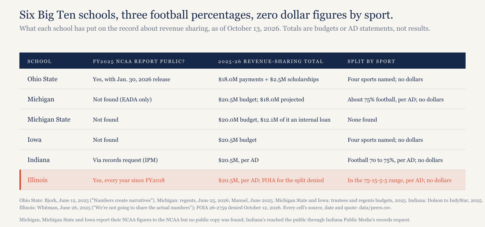
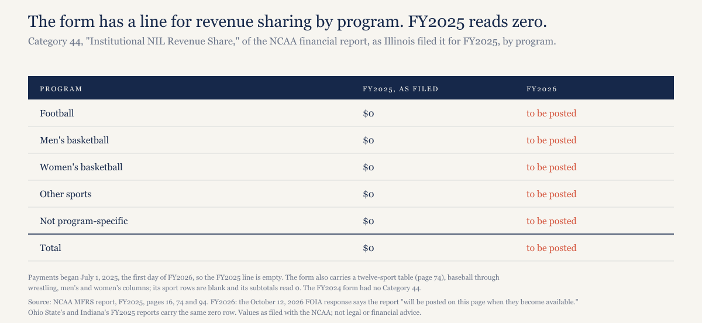
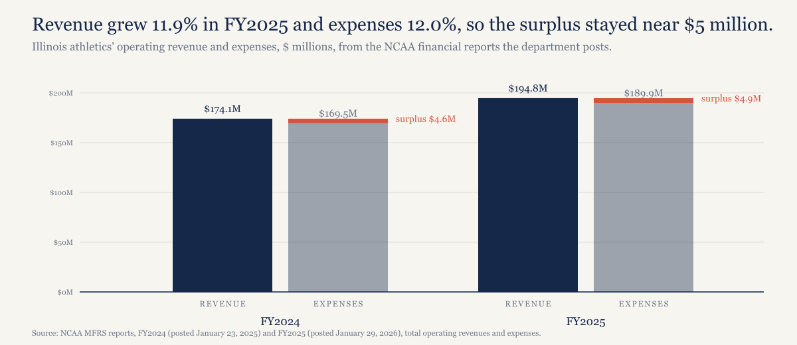
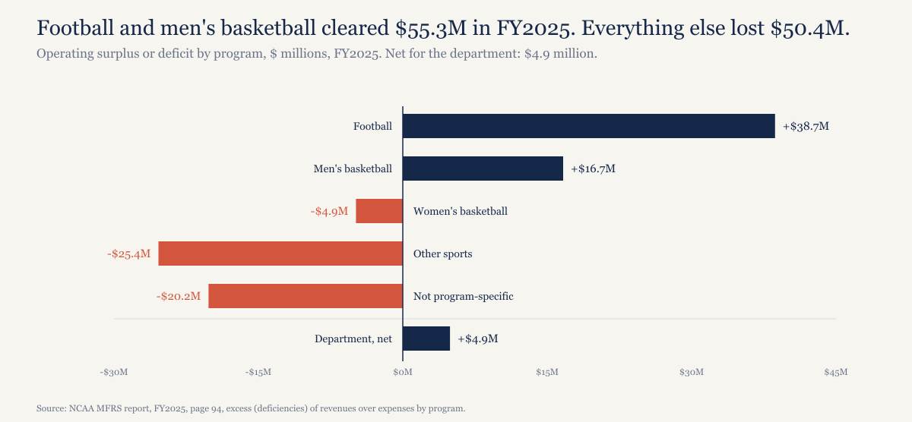

# No Big Ten school has published revenue sharing by sport in dollars. Illinois is the one that posts the form built to show it.

*On October 12, 2026, the University of Illinois denied my records request for what it paid athletes by sport, and none of five Big Ten peers has published that number either. What sets Illinois apart is that it posts its NCAA financial report every January, and that report now has a line, Category 44, for exactly this. The next one covers the first year of payments.*

---

*Construction note. Illinois's dollar figures are from the NCAA Membership Financial Reporting System reports it posts on its own disclosure page, FY2024 and FY2025, read from the PDFs' text; each number in the data file cites the line it came from, and model/recompute.py fails if a cited line doesn't carry it. The letter is quoted from the PDF, checked by script. The peer facts are in data/peers.csv with a URL, publisher, date and an exact quote for each, and the script checks every quote against the saved source text. Ohio State's and Indiana's figures are from their FY2025 NCAA reports; Michigan's, Michigan State's and Iowa's are from governing-board budget documents, which are budgets, not results. Where I couldn't reach a document I say "not found" rather than guess. I'm reading two exemptions in a state statute as a reader, not a lawyer; none of this is legal or financial advice.*

*Disclosure: I'm an Illinois football fan.*

---

## What I asked for, and what everyone has said

On October 5, 2026, I filed a Freedom of Information Act request with the University of Illinois for the total paid to athletes under the House settlement in fiscal 2026 broken down by sport, the planned split for fiscal 2027, and the FY2025 and FY2026 NCAA financial reports. Aggregates, not names. The answer came October 12: points one and two denied, point three answered with a link to the disclosure page.

Before reading the denial as an Illinois story, I went looking for whether any comparable Big Ten school had published the number I asked for. Six schools, the five public neighbors plus Illinois: Ohio State, Michigan, Michigan State, Iowa and Indiana. None has published revenue sharing in dollars by sport. Here is what each has said, from its own documents or its athletic director's mouth.

*[Caption: figures/captions.md, fig-01-peer-table]*

Ohio State committed $18 million to athletes in four sports, football, men's and women's basketball and women's volleyball, with the remaining $2.5 million of the cap going to 91 added scholarships. Asked for the split, Ross Bjork said: "Numbers create narratives, so we're not going to get into calculating how much this program gets or that program." Michigan's regents budgeted $20.5 million for FY2026, projected $18.0 million actually spent, and budgeted $21.32 million for FY2027; Warde Manuel said in June 2025 that about 75 percent, roughly $15.38 million, would go to football, "then men's basketball, then women's basketball, and then we're sprinkling in a couple of others." Michigan State's trustees budgeted $20,000,000 for FY2026, financed in part by a $12,063,922 internal loan, and $21,320,000 for FY2027 against a projected athletics deficit of $10,555,220, "to be addressed through internal loan financing." Iowa's regents budgeted $20.5 million, then $21.32 million; the department's Flight Funds support "football, men's basketball, women's basketball and men's wrestling." Indiana's Scott Dolson told IndyStar that football would get 70% to 75% of a $20.5 million budget in year one.

And Illinois. Josh Whitman said in June 2025 that the department would distribute all $20.5 million, that new scholarships would come out of that total, and that the split would be "in those ranges" of the 75-15-5-5 rule of thumb most schools use, with football, men's and women's basketball and volleyball "receiving more than 98 percent of the shared revenue." Then: "We're not going to share the actual numbers." This June he said the first year of revenue sharing added almost $21 million of expense, that 223 athletes received something, and that it will top $21 million this year.

So the count is: six schools, three percentages for football (Michigan, Indiana, Illinois), four lists of sports, zero dollar figures by sport. Illinois's denial matches what its peers have done.

## The two exemptions, briefly

The denial rests on 5 ILCS 140/7(1)(g), which the letter quotes as exempting "Trade secrets and commercial or financial information obtained from a person or business where the trade secrets or commercial or financial information are furnished under a claim that they are proprietary, privileged or confidential, and that, or where, disclosure of the trade secrets or commercial or financial information would cause competitive harm to the person or business…" The university's reasoning: "Given the institution-specific discretion in allocating revenue-sharing payments across sports and between student-athletes, the requested information is inextricably linked to the competitive strategies of the University. The release of these records would cause competitive harm by allowing other institutions to learn, replicate and/or exploit University of Illinois allocation strategies and priorities."

The statute's own words cover information "obtained from a person or business" and "furnished under a claim" of confidentiality. A department's division of its own money among its own teams wasn't obtained from anyone; on the text alone, that's an awkward fit, and the competitive-harm argument looks thin when the AD has already said football gets about three-quarters. The second ground, 5 ILCS 140/7.5(sss), is the stronger one. It exempts "Information exempt from disclosure under Section 40 of the Student-Athlete Endorsement Rights Act," which the letter says "includes 'Information written, produced, collected, assembled, or otherwise maintained by a postsecondary educational institution that includes, reveals, or otherwise relates to the terms of an existing or proposed student-athlete publicity rights agreement.'" Schools commonly structure revenue sharing as licenses of each athlete's publicity rights, and if Illinois does, a by-sport total "relates to the terms" of them in the broad sense a records officer will read. Its language is broad. Not legal advice; I'm reading the words. The letter notes I can ask the Public Access Counselor to review it, and I'd rather wait for January.

## The form

Every Division I school files a Membership Financial Reporting System report with the NCAA after each fiscal year. Of the six schools here, two put the FY2025 report where the public can read it: Ohio State attached its 94-page report to a January 30, 2026 press release on its record $336,077,887 of revenue, and Illinois posted its FY2025 report, 94 pages with the auditor's letter, on its disclosure page on January 29, 2026, as it has for every year since FY2018. Indiana's report reached the public because Indiana Public Media obtained it "through a public records request" in February. Michigan posts its federal EADA survey, a different and thinner form. Michigan State's and Iowa's I couldn't find anywhere.

Between the FY2024 and FY2025 filings the NCAA changed the form. The FY2024 expense categories run from 20 to 41A, and the last of them is coaching bonuses for a bowl game. The FY2025 form runs to 44, and Category 44 is "Institutional NIL Revenue Share": in the NCAA's instruction, "institutional payments to student-athletes for use of Name, Image and Likeness (NIL) (including from institutional designee or contractor)," plus other direct payments the settlement permits. In Illinois's FY2025 report it appears on page 16, defined and totaled; on page 94, by program, with columns for football, men's basketball, women's basketball, other sports and non-program expenses; and on page 74 as a twelve-sport table, baseball through wrestling, men's and women's teams in separate columns. Ohio State's and Indiana's FY2025 reports have the same row.

Every cell is zero or blank, at all three schools. That's the calendar, not a redaction: revenue sharing began July 1, 2025, the first day of fiscal 2026, so the FY2025 form shows the line with nothing on it. The FY2026 form is the first where Category 44 carries money, by program and by sport.

*[Caption: figures/captions.md, fig-02-category-44]*

That's where Illinois's habit matters. The October 12 letter, after denying the by-sport records, says of the FY2026 report: "2026 NCAA MFRS reports will be posted on this page when they become available." If the FY2026 report goes up the way the last eight did, the by-sport split that nobody in this group has published will be on page 74 of a PDF on fightingillini.com, filled in by Illinois's own finance staff, sometime around the end of January. Ohio State may do the same with its release. The others haven't posted theirs so far.

## Illinois's budget, for scale

Fairness requires the scale. Illinois ran a surplus of $4.9 million in fiscal 2025, on $194.8 million of revenue against $189.9 million of expenses; the year before, $4.6 million. Revenue grew 11.9% and expenses grew 12.0%, which is why the surplus barely moved. Ohio State's revenue was $336.1 million, 1.7 times Illinois's. Indiana's was $183.4 million. Illinois is working with the same $20.5 million cap as Ohio State, from a department a little over half Ohio State's size.

*[Caption: figures/captions.md, fig-03-revenue-expenses]*

Where the money came from is plain on the FY2025 form. Football cleared $38.7 million on $87.9 million of revenue, up 27.9% in a year; men's basketball cleared $16.7 million. Together, $55.3 million. Everything else lost it back, $50.4 million in all: women's basketball $4.9 million, the other sports $25.4 million, and $20.2 million of expense not tied to any program. Net, $4.9 million. A department shaped like that and told to spend $20.5 million on athletes will put about three-quarters of it into football, which is what Whitman said it would do, and what Manuel and Dolson said their departments would do. The by-sport dollars aren't a scouting secret. They're the published ratio applied to a published cap.

*[Caption: figures/captions.md, fig-04-surplus-by-program]*

Whitman has said revenue passed $200 million in fiscal 2026, per the trustees' memo on his contract, and that revenue sharing added almost $21 million of expense. The FY2026 report will show whether that cleared the cushion, and Category 44 will show where it went.

## What would make this wrong

The NCAA could change the FY2026 form before schools file it; Category 44 could be redefined, moved or dropped. I've checked the FY2025 forms only.

Illinois could post the FY2026 report with the by-sport table omitted or the Category 44 cells redacted. The eight reports on the page so far are complete, so there's no precedent for that, but the letter's promise is to post "2026 NCAA MFRS reports," not every page of them.

The peer facts are as thin as their sources. Michigan's, Michigan State's and Iowa's numbers are budget lines, not results. Indiana's percentage reached me through a reprint of IndyStar, not the original; a "roughly 20 percent to men's basketball" figure I was told about I couldn't find anywhere, so it isn't here. Michigan's Faculty Senate minutes naming five sports I couldn't retrieve, so Michigan is credited only with what its AD said. The University of Illinois trustees' materials I could reach carry no revenue-sharing total, and the board's agenda site refuses scripted requests.

The statutory reading is mine. A court or the Public Access Counselor could hold that an allocation is "commercial or financial information" within 7(1)(g) whatever its origin, or that 7.5(sss) reaches aggregates. I've said which is stronger; I haven't said either fails.

## What this predicts

Illinois posts its FY2026 NCAA financial report on the disclosure page by February 28, 2027, with Category 44 filled in by program and by sport, and becomes one of the first of these six schools to put the by-sport dollars on the public record. If the posting is late, or Category 44 is redacted or the by-sport table left out, then the denial letter was the policy and the posting habit has changed.

## The data

Everything is in [`illinois-revenue-sharing-2026/`](https://github.com/mgag70-prog/hqsports-research/tree/main/illinois-revenue-sharing-2026). `data/mfrs-summary.csv` holds the FY2024 and FY2025 Illinois revenue, expense, surplus and Category 44 rows by program, each citing the line of the report text it came from; `data/peers.csv` holds every peer fact with its URL, publisher, date and exact quote; `data/context.csv` the cap and the dates. `model/recompute.py` re-reads the cited lines, recomputes every figure above, confirms Category 44 shows no payment anywhere in the FY2025 reports (six zeros by program on page 94 of Illinois's; blank sport rows and zero subtotals on page 74) and is absent from the FY2024 form, and checks every quotation from the letter and from the peer sources against saved text; it fails on any mismatch. Sources: FOIA 26-2759 response, University of Illinois System, October 12, 2026; [Illinois DIA disclosure documents](https://fightingillini.com/sports/2021/12/2/disclosure-documents); [FY2025 NCAA report](https://fightingillini.com/documents/2026/1/29/FY25_IL_NCAA_Full_Report__Revised_1-22-26_.pdf); [FY2024 NCAA report](https://fightingillini.com/documents/2025/1/23/UIUC_NCAA_Report_Final_1.15.25.pdf); [Ohio State's FY2025 release and report](https://news.osu.edu/ohio-state-athletics-sets-record-with-336m-in-fy25-revenue-after-national-championship-season/), January 30, 2026; The Lantern, June 18, 2025; Athletic Business, June 16, 2025; 247Sports, June 12, 2025 (Bjork) and June 7, 2025 (Manuel); [Michigan regents, FY2027 athletics budget](https://regents.umich.edu/files/meetings/06-26/2026-06-X-8.pdf), June 25, 2026; Michigan State trustees, Budget and Finance attachment 1, June 13, 2025 and [June 12, 2026](https://edge.sitecorecloud.io/michiganstab57e-msustrategi129d-prod9868-7e5e/media/project/msu/trustees/docs/2026/06-12-26/bf1-approval-of-fy2027-operating-budget-and-tuition-rates.pdf); Iowa Board of Regents, [July 30, 2025](https://www.iowaregents.edu/media/cms/0725_ITEM_9__Budgets_B7978EBC54888.pdf) and [July 29, 2026](https://www.iowaregents.edu/media/cms/0726_ITEM_6__Budgets_E0058D444AE7B.pdf); hawkeyesports.com, June 9, 2025; [Indiana Public Media](https://www.ipm.org/news/2026-02-19/iu-says-56-million-for-athletic-department-the-past-two-years-were-loans), February 19, 2026, and Indiana's FY2025 report; IndyStar via Tallen Capital's reprint; The News-Gazette, June 26, 2025 and June 26, 2026; 247Sports, June 26, 2026; Chicago Sun-Times, July 16, 2026; the cap: [Sportico, July 18, 2025](https://www.sportico.com/leagues/college-sports/2025/division-i-revenue-sharing-schools-list-college-sports-1234863224/).

---

## Not for publication

Alternate titles:

1. Six Big Ten schools, three percentages, zero dollar figures: revenue sharing by sport is nobody's public record yet. Illinois's January report could change that.
2. Illinois denied my FOIA. Its peers would have too. Its NCAA report may answer anyway.

Open items: the prediction wording; whether to name the records officer (she signed a public record); the original IndyStar article and the "roughly 20 percent" men's basketball figure are unverified and left out; Michigan's FAAC minutes (April 9, 2026) not retrieved; MSU FY2026 attachment is a WLNS-hosted copy of the trustees' document, cross-checked against the FY2026 column of the trustees' own June 12, 2026 attachment; raw/peers/ holds the fetched source texts the script checks quotes against (same pattern as the lockout piece's raw text), decide whether to commit them; the 7.5(sss) reading rests on the letter's quotation of Section 40.
