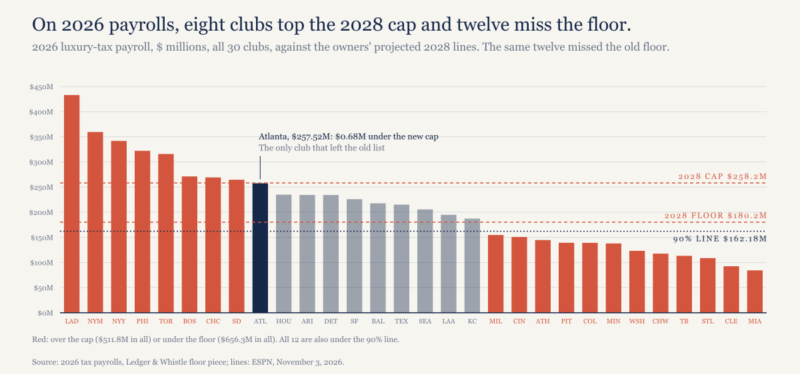
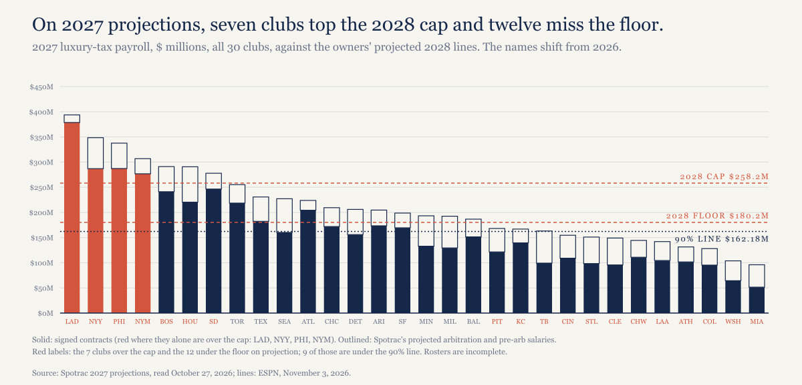
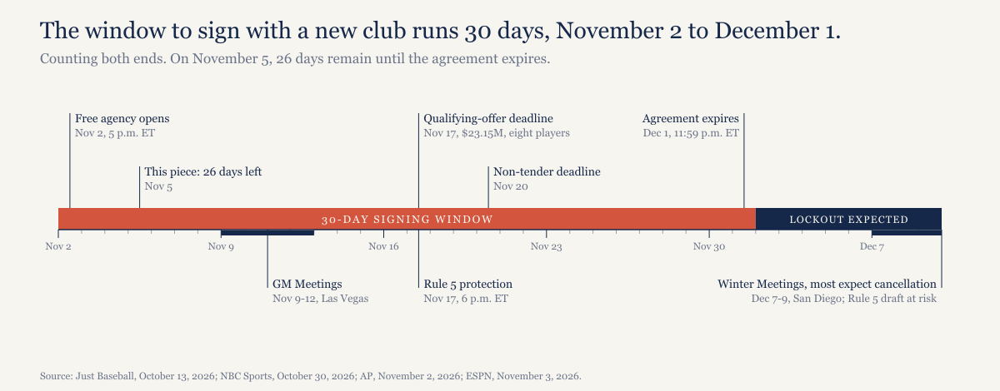

# 26 days left. The owners moved their salary cap to 2028, and it catches 20 of the same 21 teams.

*MLB's new offer pushes the cap to 2028. On this year's payrolls it hits 8 clubs over and 12 under, and only Atlanta gets off the list.*

---

## What changed on Tuesday

MLB went back to the union on Tuesday, November 3rd, and pushed its salary cap back a year, to 2028, Jeff Passan reported at ESPN. The rest of its 2027 offer stays on the table, and the luxury-tax thresholds wouldn't change for 2027.

The numbers moved with the date. The cap goes from $245.3 million to a projected $258.2 million, up $12.9 million, and the floor goes from $171.2 million to $180.2 million, up $9.0 million, on a 50-50 split of projected 2028 revenue. Each rose 5.3%, which leaves the floor at 69.8% of the cap, right where it was. That's the same system on a later date.

One thing is new: the floor now has some give. A club could spend as little as 90% of it in a given year, $162.18 million, if it meets a minimum over several years.

MLB also offered players $282 million of luxury-tax proceeds in cash, though ESPN's sources say IRS limits hold the present-day payout to about $72 million. Add a $900,000 minimum salary (some players would get $1 million) and a $65 million pre-arbitration pool, both inside an offer ESPN describes as contingent on the union accepting a cap and floor.

The union isn't interested. It opposes any cap, says players would lose more than $1 billion over the life of the proposal, and said in a statement that owners "continue to propose blowing up the current system and replacing it with one designed to line their pockets." Its own counter keeps the current framework: a $300 million base tax threshold, a $1.5 million minimum (up from $780,000) and a $180 million pre-arbitration pool, which is $50 million today.

## Same lines, nearly the same clubs

26 days. Same lines.

ESPN counted eight clubs above the new ceiling and twelve below the new floor, the Brewers among them. I ran 2026 luxury-tax payrolls against $258.2 million and $180.2 million and got the same count. Over: the Dodgers, Mets, Yankees, Phillies, Blue Jays, Red Sox, Cubs and Padres, $511.8 million above the line in all. Under: Milwaukee, Cincinnati, the Athletics, Pittsburgh, Colorado, Minnesota, Washington, the White Sox, Tampa Bay, St. Louis, Cleveland and Miami, $656.3 million below it.

*[Caption: figures/captions.md, fig-01-2026-vs-2028-lines]*

Against the old numbers in my [floor piece](https://ledgerandwhistle.substack.com/p/baseballs-best-team-would-have-been), nine clubs were over and the same twelve were under. Atlanta is the only club that changed sides: its $257.52 million sits $0.68 million below the new cap. The other 20 stay exactly where they were.

The 90% rule rescues nobody on this list, because all 12 were below $162.18 million too. It does shrink the bill. Reaching the full floor would take those clubs $656.3 million; reaching the 90% line takes $440.0 million in any year they all use it.

That changes the arithmetic from my floor piece, where the old lines took $79.0 million away from players as a group. On the new lines, the floor adds more than the cap removes, by $144.4 million, unless all twelve stop at 90%, and then it's $71.8 million the other way. I wouldn't lean on either figure. This is a 2026 payroll held against a 2028 line, two seasons apart, so it shows you who the system aims at and says nothing about what clubs will spend in 2028.

## The 2027 numbers shuffle the names

Spotrac's 2027 projections, read October 27 with rosters still incomplete, put 7 clubs over the 2028 cap, 12 under the floor and 9 under the 90% line. The counts hold better than the names do. Houston joins the top group while Toronto and the Cubs drop out, and the Angels and Royals slide under the floor as the Brewers and Twins climb over it.

*[Caption: figures/captions.md, fig-02-2027-vs-2028-lines]*

Signed contracts alone already put the Dodgers, Yankees, Phillies and Mets over $258.2 million, and the Dodgers project $135.6 million over.

Milwaukee is the odd one. The 2026 World Series Champions project at $192.41 million for 2027, $12.21 million above the 2028 floor, and $58.0 million of the total is arbitration salaries, which is why [The Ledger](https://ledgerandwhistle.substack.com/p/the-ledger-october-2026) has my floor call at risk.

## What December 2 freezes

Free agency opened at 5 p.m. ET on November 2nd. The GM Meetings run November 9-12 in Las Vegas, eight players got the $23.15 million qualifying offer on November 2nd and have until November 17th to answer, clubs must protect players from the Rule 5 draft by 6 p.m. ET on November 17th, and the non-tender deadline is November 20th.

The agreement expires at 11:59 p.m. ET on December 1st, and the lockout, if it comes, starts December 2nd. Players couldn't contact team staff or use team facilities, and transactions would freeze. Most people expect the December 7-9 Winter Meetings in San Diego to be cancelled, and the Rule 5 draft is at risk.

*[Caption: figures/captions.md, fig-03-calendar]*

So a free agent's window to sign with a new club runs November 2nd to December 1st: 30 days, counting both ends. Anyone unsigned when it shuts waits for a new agreement.

## Last time

The 2021-22 lockout ran from December 2, 2021 to March 10, 2022, 99 days counting both ends. Opening Day moved back from March 31st, and the season still reached 162 games because the postponed ones got made up.

ESPN, using that cycle as its guide, expects no proposals in December and the sides back together in the middle or end of January. Its hard date is the start of May. Losing 60 or more games would extend most national TV contracts by a year, so avoiding that takes games by about June and a deal by early May. That's ESPN's reasoning, and I'm not forecasting past December 2nd.

## The countdown

| Lockout countdown | Week 1 |
|---|---|
| Days left | 26 |
| Last proposal | MLB, November 3 |
| Union's last counter | As reported November 3 |
| Next dates | Qualifying-offer deadline November 17th; Rule 5 protection November 17th; non-tender November 20th |

Next week's countdown runs Wednesday, November 11th.

## What I expect

No new agreement by 11:59 p.m. ET on December 1, and the owners lock out the players on December 2. Checkable December 2.

## About this piece

*Construction note. Payrolls for 2026 are the luxury-tax figures from my floor piece; 2027 figures are Spotrac's projections, read October 27, 2026, before free agency, so they'll move. Projected adds Spotrac's arbitration and pre-arbitration estimates to signed contracts. The 2028 cap and floor are MLB's projections as ESPN reported them, not agreed numbers, and setting them against earlier payrolls shows where the lines fall today, not where clubs will be in 2028. Differences are computed before rounding. Days left counts from November 5 to December 1; the signing window and the 2021-22 lockout count both end dates. Every number is recomputed from the data files by model/recompute.py. Not legal or financial advice.*

*Disclosure: I held Cubs season tickets from 1998 to 2021. The Cubs are among the 8 over, at $269.22 million.*

## Sources

- ESPN (Jeff Passan), [MLB proposes delaying salary cap until 2028 season](https://www.espn.com/mlb/story/_/id/50370860/mlb-proposes-delaying-salary-cap-2028-season), November 3, 2026
- ESPN via TSN, [Will there be a lockout? A salary cap? MLB's labour battle explained](https://www.tsn.ca/mlb/article/will-there-be-a-lockout-a-salary-cap-mlbs-labor-battle-explained-n1-50370123/), November 3, 2026
- Just Baseball (Leo Morgenstern), [2026-27 MLB Offseason: Key Dates](https://www.justbaseball.com/mlb/offseason-schedule-key-dates-lockout/), October 13, 2026
- AP via KSL (Ronald Blum), [Bednar, Suzuki and Arozarena are among 8 MLB players receiving $23.15 million qualifying offers](https://www.ksl.com/article/51643185/bednar-suzuki-arozarena-among-8-receiving-2315-million-qualifying-offers), November 2, 2026
- NBC Sports (Eric Samulski), [MLB Offseason Calendar 2026-27: Key dates, free agency and lockout questions answered](https://www.nbcsports.com/mlb/news/mlb-offseason-calendar-2026-27-key-dates-free-agency-and-lockout-questions-answered), October 30, 2026
- Wikipedia, [2021–22 Major League Baseball lockout](https://en.wikipedia.org/wiki/2021%E2%80%9322_Major_League_Baseball_lockout)
- Ledger & Whistle, [Baseball's best team would have been under the owners' salary floor](https://ledgerandwhistle.substack.com/p/baseballs-best-team-would-have-been), payroll data from Spotrac
- Ledger & Whistle, [The Dodgers are already $133 million over a 2027 salary cap, before they sign anyone.](https://ledgerandwhistle.substack.com/p/the-dodgers-are-already-133-million), 2027 data from Spotrac
- Data and checking script: [lockout-countdown-2026 on GitHub](https://github.com/mgag70-prog/hqsports-research/tree/main/lockout-countdown-2026)

---

## Not for publication

Alternate titles:

1. The owners delayed the cap a year. The new lines land on 20 of the same 21 clubs.
2. Outline working H1, not used: "26 days left. The owners moved their salary cap to 2028, and it catches the same 20 teams."

Cover line (verbatim in "Same lines, nearly the same clubs"): 26 days. Same lines.

Open items:

- Contingency: the outline says all of the offer is contingent on a cap and floor. ESPN's sentence names earlier free agency as contingent and lists the minimum and the pool after "while proposing", and it gives no contingency for the $282 million. The draft doesn't attach the $282 million to it. MLB's statement says a "$1 million minimum salary"; ESPN's body says $900,000 with some at $1 million.
- Signing window: the outline said sign or trade. NBC's calendar has trades reopening October 29, so the draft limits the 30 days to signing with a new club.
- Counting: 26 days left excludes the start date; 30 and 99 count both ends. The piece says so. Elapsed, the window is 29 days.
- Figures not in the outline, all computed in model/recompute.py: 5.3%, 69.8%, $0.68 million, $440.0 million, $144.4 million, $71.8 million. $144.4 million is unrounded $656.27 million less $511.84 million, so it won't match the rounded figures by a tenth; the About note says so.

RECHECK before publishing:

- Any new proposal or union response since November 3.
- Days left if publication slips past November 5: the H1, cover line, tracker and thread all carry 26.
