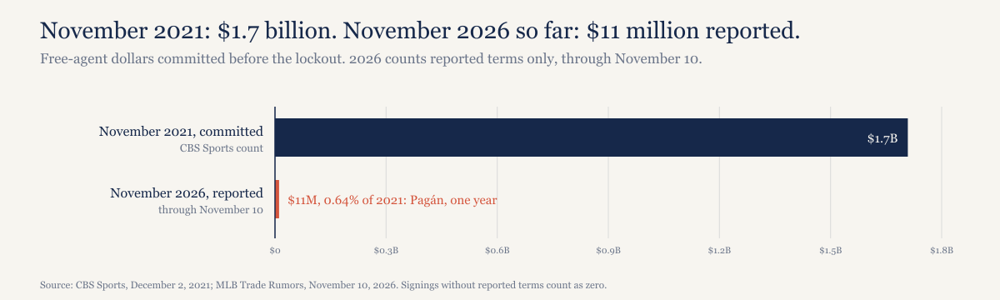
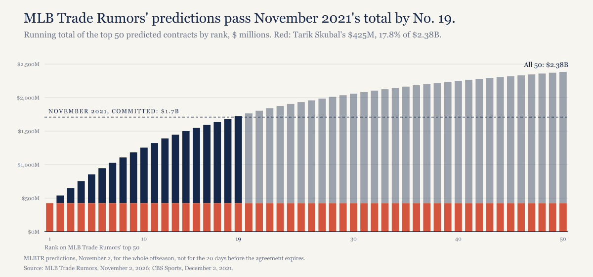
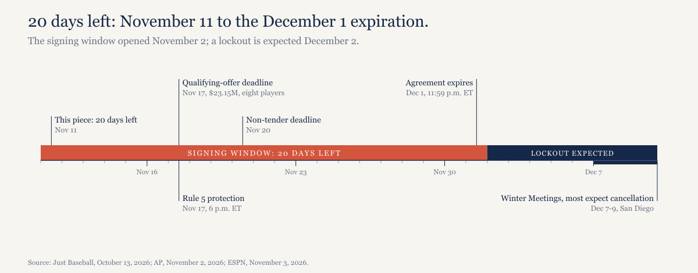

# 20 days left, and the MLB free-agent market has moved $11 million.

*Before the 2021 lockout, teams committed $1.7 billion in November. Nine days into this window, the first significant deal is one year.*

---

## Where the talks stand

Nothing new has crossed the table. MLB's last offer came on Tuesday, November 3, when it pushed its salary cap back to 2028, and the union rejected it the same day, MLB Trade Rumors reported. I looked again on November 9 and again today and found no new proposal and no counter. [Last week's countdown](https://ledgerandwhistle.substack.com/p/26-days-left-the-owners-moved-their) has the numbers in that offer, and none of them has changed.

The agreement expires at 11:59 p.m. ET on December 1, 20 days from today.

## The money that moved last time

Dayn Perry at CBS Sports added it up the day the last lockout began: in November 2021, clubs committed more than $1.7 billion to free agents before the December 2 lockout. Five of those contracts reached nine figures. The Rangers alone spent $561.2 million, 32.8% of the total, on Corey Seager (10 years, $325 million), Marcus Semien (7 years, $175 million) and Jon Gray.

That was a market racing a deadline everyone could see. This one has the same kind of deadline, and so far it isn't racing.

## The money that has moved this time

Free agency opened at 5 p.m. ET on November 2, and more than 140 players hit the market, by Mike Axisa's count at CBS Sports. Then on November 10, day 9 of the 30-day window, the Tigers agreed with reliever Emilio Pagán on a one year deal worth about $11 million, Jon Heyman reported in the New York Post. MLB Trade Rumors called it "this year's first significant move on the free agent market."

Pagán had turned down a $10 million player option with Cincinnati less than two weeks earlier, so the open market paid him about $1 million more for walking away from it. It paid him less than MLB Trade Rumors expected, though; its prediction was two years and $20 million, No. 35 on its top 50.

The two other signings I've found came without reported terms: Ryan Weiss to the Padres on one year with a club option, and Robert Stock to the Mets. Count those as zero and the reported total through November 10 is $11 million, 0.64% of what clubs committed in November 2021.

20 days. $11 million.

*[Caption: figures/captions.md, fig-01-2021-vs-2026-dollars]*

## What the market could still do

The big numbers so far are predictions. MLB Trade Rumors' top 50, published November 2, adds up to $2.38 billion, 1.39 times November 2021, and the first 19 names on the list pass the 2021 total by themselves. Tarik Skubal is 17.8% of it on his own, predicted at nine years and $425 million; take him out and the other 49 come to $1.96 billion. There are five predicted nine-figure deals (Skubal, Trevor Rogers, Freddy Peralta, Seiya Suzuki and Randy Arozarena), the same count as November 2021.

*[Caption: figures/captions.md, fig-02-top50-predictions]*

Those are predictions for the whole offseason, not for the next 20 days, so $2.38 billion isn't what signs before December 1. Nobody's forecasting that, and I'm not either.

Skubal is the one who might move fast. He's hoping to get a deal done before the lockout, Heyman reported, and the Mets have a meeting with him set for next week; Dodgers general manager Brandon Gomes says his club expects to meet with him as well.

Why would anyone else wait? An unnamed official put it to Julian McWilliams of CBS Sports this way: "We're really operating under uncertainty now." An agent in the same piece said, "Nothing motivates clubs more than a deadline." My read, and it's mine rather than anything a club has said, is that the owners' own offer explains the hesitation. If a cap arrives in 2028, every long contract signed this month is a bet on rules nobody has agreed to, and a club can't yet know whether that contract leaves it over a line or under one.

## The next dates

The eight players who got the $23.15 million qualifying offer have until Tuesday, November 17 to answer, the AP reported, and clubs must protect players from the Rule 5 draft by 6 p.m. ET the same day. The non-tender deadline is November 20. Then the agreement runs out at 11:59 p.m. ET on December 1, and most people expect the December 7-9 Winter Meetings in San Diego to go with it.

*[Caption: figures/captions.md, fig-03-calendar]*

## The countdown

| Lockout countdown | Week 2 |
|---|---|
| Days left | 20 |
| Last proposal | MLB, November 3 |
| Union's last counter | As reported November 3 |
| Reported free-agent dollars | $11 million |
| Next dates | Qualifying-offer deadline November 17; Rule 5 protection November 17; non-tender November 20 |

Next week's countdown runs Wednesday, November 18.

## What I expect

Clubs commit less to free agents before the lockout than the $1.7 billion they committed in November 2021. Checkable December 2 against the published tallies at CBS Sports and MLB Trade Rumors. Last week's call stands: no new agreement by 11:59 p.m. ET on December 1, and a lockout on December 2.

## About this piece

*Construction note. Dollars for 2026 are reported terms only. A signing without reported terms counts as zero, so $11 million is the least clubs have committed, not an estimate of the total. The November 2021 figure is CBS Sports' count from December 2, 2021, which left out Javier Báez's $140 million deal, made official December 1. MLB Trade Rumors' top 50 are predictions for the full offseason, published November 2, and say nothing about when anyone signs. Days left counts from November 11 to December 1; the 30-day window counts both ends, November 2 to December 1. Every number is recomputed from the data files by model/recompute.py. Not legal or financial advice.*

*Disclosure: I held Cubs season tickets from 1998 to 2021. Three players on MLB Trade Rumors' top 50 were last with the Cubs: Seiya Suzuki (No. 4), Ian Happ (No. 17) and Shota Imanaga (No. 21).*

## Sources

- CBS Sports (Dayn Perry), [MLB free agency: Teams commit $1.7 billion to free agents in November before locking out players](https://www.cbssports.com/mlb/news/mlb-free-agency-teams-commit-1-7-billion-to-free-agents-in-november-before-locking-out-players), December 2, 2021
- CBS Sports (Mike Axisa), [Why MLB could see an early free agency frenzy before the potential Dec. 1 lockout](https://www.cbssports.com/mlb/news/mlb-free-agency-frenzy-november-lockout/), November 3, 2026
- CBS Sports (Julian McWilliams), [How busy will the MLB offseason be before likely lockout? Insiders weigh in on November's urgency, uncertainty](https://www.cbssports.com/mlb/news/how-busy-mlb-offseason-likely-lockout-insiders-november-urgency-uncertainty/), November 4, 2026
- MLB Trade Rumors, [MLB Issues Latest Proposal To MLBPA; Union Swiftly Rejects](https://www.mlbtraderumors.com/2026/11/mlb-proposal-salary-cap-2028-five-year-free-agency-million-league-minimum.html), November 3, 2026
- MLB Trade Rumors (Anthony Franco), [Tigers To Sign Emilio Pagán](https://www.mlbtraderumors.com/2026/11/tigers-to-sign-emilio-pagan.html), November 10, 2026
- MLB Trade Rumors (Anthony Franco), [Padres Sign Ryan Weiss](https://www.mlbtraderumors.com/2026/11/padres-ryan-weiss-agree-to-major-league-deal.html), November 10, 2026
- ESPN, [MLB free agency tracker: 2026-27 offseason trades, moves](https://www.espn.com/mlb/story/_/id/50328768/free-agency-tracker-offseason-trades-moves-2026-2027)
- MLB Trade Rumors, [2026-27 Top 50 Free Agents With Predictions](https://www.mlbtraderumors.com/2026/11/2026-27-top-50-free-agents-with-predictions.html), November 2, 2026
- MLB Trade Rumors (Steve Adams), [Mets Meeting With Tarik Skubal](https://www.mlbtraderumors.com/2026/11/mets-rumors-tarik-skubal-meeting-free-agent.html), November 10, 2026
- MLB Trade Rumors (Darragh McDonald), [Dodgers Expect To Have Meeting With Tarik Skubal](https://www.mlbtraderumors.com/2026/11/dodgers-expect-to-have-meeting-with-tarik-skubal.html), November 10, 2026
- AP via KSL (Ronald Blum), [Bednar, Suzuki and Arozarena are among 8 MLB players receiving $23.15 million qualifying offers](https://www.ksl.com/article/51643185/bednar-suzuki-arozarena-among-8-receiving-2315-million-qualifying-offers), November 2, 2026
- Just Baseball (Leo Morgenstern), [2026-27 MLB Offseason: Key Dates](https://www.justbaseball.com/mlb/offseason-schedule-key-dates-lockout/), October 13, 2026
- NBC Sports (Eric Samulski), [MLB Offseason Calendar 2026-27: Key dates, free agency and lockout questions answered](https://www.nbcsports.com/mlb/news/mlb-offseason-calendar-2026-27-key-dates-free-agency-and-lockout-questions-answered), October 30, 2026
- ESPN (Jeff Passan), [MLB proposes delaying salary cap until 2028 season](https://www.espn.com/mlb/story/_/id/50370860/mlb-proposes-delaying-salary-cap-2028-season), November 3, 2026
- Ledger & Whistle, [26 days left. The owners moved their salary cap to 2028](https://ledgerandwhistle.substack.com/p/26-days-left-the-owners-moved-their), November 5, 2026
- Data and checking script: [lockout-countdown-2026 on GitHub](https://github.com/mgag70-prog/hqsports-research/tree/main/lockout-countdown-2026)

---

## Not for publication

Alternate titles:

1. Clubs committed $1.7 billion in November 2021. This November, the reported total is $11 million.
2. The first significant free-agent deal took nine days, and it was one year.

Cover line (verbatim in "The money that has moved this time"): 20 days. $11 million.

Open items:

- Skubal meetings: the outline says the Dodgers and Mets are meeting Skubal "this week at the GM Meetings in Las Vegas." MLBTR's posts (raw/mlbtr-home.html) say the Mets meeting is "next week" and the Dodgers only "expect to have a meeting with him at some point in the near future." Neither mentions the GM Meetings. The draft follows MLBTR.
- Disclosure: the outline asked about Happ (17) and Imanaga (21); both are confirmed as last with the Cubs in raw/mlbtr-top50.html. So is Seiya Suzuki (4), whose "five-year, $85MM contract with the Cubs" just ended, and he's named in the body as a predicted nine-figure deal, so the disclosure adds him.
- November 2021: CBS's $1,708,600,000 excludes Báez's $140 million (official December 1). The About note says so. The 2021 window length isn't stated anywhere, per the outline.
- Figures not in the outline, computed in model/recompute.py: the first 19 predictions pass $1.7 billion (running total $1,724 million at No. 19); the other 49 without Skubal.
- MLBTR timestamps the Pagán post 11:17 p.m. CDT; context.csv says 11:18 p.m. CT. Doesn't reach the draft.

RECHECK before publishing:

- Any new signing with reported terms on November 11 (GM Meetings end November 12). Update data/signings.csv, the reported total, the H1, the cover line and the thread if it changes.
- Any new proposal or union response.
- Prediction: replace the [MATT TO CONFIRM] tag once confirmed; recompute.py's tag check flips with it.
