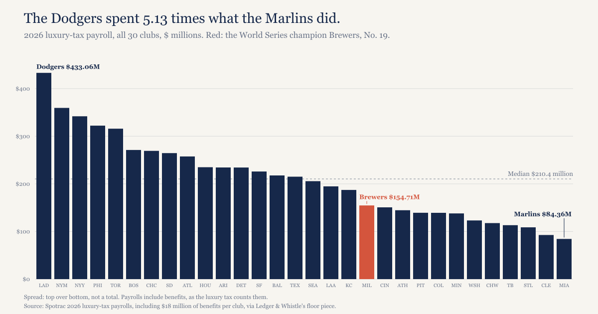
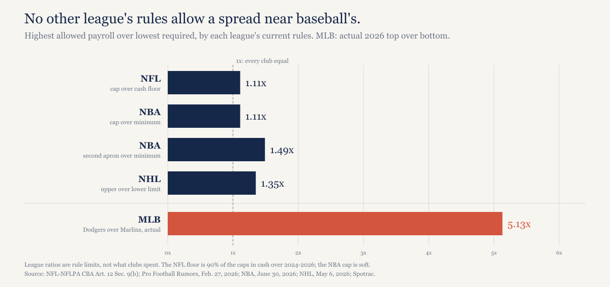

# 13 days left, and MLB took its salary-cap case to fans. Its biggest claim checks out on payroll.

*MLB says baseball has the widest payroll gap in sports. On 2026 payrolls the top club spent 5.13 times the bottom one.*

---

## Where the talks stand

Nothing has moved at the table. MLB's last offer came on November 3, and the union rejected it the same day, MLB Trade Rumors reported; I checked again on November 16 and November 17 and found no new proposal and no counter. The agreement expires at 11:59 p.m. ET on December 1, 13 days from today. [Week 1](https://ledgerandwhistle.substack.com/p/26-days-left-the-owners-moved-their) has what's in that offer, and [week 2](https://ledgerandwhistle.substack.com/p/20-days-left-and-the-mlb-free-agent) has the free-agent market against 2021, so I won't repeat either.

What changed is the audience. As part of its "Level the Playing Field" campaign, MLB released a five-minute video, "Baseball's Payroll Disparity Problem Explained: The Case for a Salary Cap and Floor," with Morgan Sword, its executive vice president of baseball operations, making the case. It's pinned on MLB's X account and had passed 1.7 million impressions there when Eric Fisher wrote it up for Front Office Sports on November 16. Sword's central line: "MLB has the widest payroll gap in sports, and it's not even close."

The union's answer came from Bruce Meyer, who told Front Office Sports the owners want a system that "artificially suppresses player salaries, player movement, and player guarantees." Free-agent pitcher Jameson Taillon was shorter about it: "comically bad."

## Checking Sword's claim

His line is about numbers, so here are the numbers. On 2026 luxury-tax payrolls, the data behind [the floor piece](https://ledgerandwhistle.substack.com/p/baseballs-best-team-would-have-been), the Dodgers spent $433.06 million and the Marlins $84.36 million. That's 5.13 times as much, a gap of $348.7 million. Nor is it one club at each end pulling the ratio apart: the top five payrolls together came to 3.43 times the bottom five. The median club spent $210.4 million.

13 days. 5.13 times.

*[Caption: figures/captions.md, fig-01-payrolls]*

The video's own example cuts the other way, though. Milwaukee, MLB's smallest media market, won the World Series with the No. 19 payroll, Sword says, and the data agrees: $154.71 million, No. 19 of 30. He sets it against the longer trend, in which higher-payroll clubs tend to win more. What the video doesn't take up is that this year's champion came out of the bottom half of a league with a 5.13-to-1 spread, which makes an awkward advertisement for the idea that the spread decides who wins.

## Against the other leagues

The NFL, NBA and NHL all have caps and floors, so the fair comparison is how wide each league's rules let payrolls spread. I've used the current figures from each league or its labor deal.

The NHL's range for 2026-27 runs from a lower limit of $76.9 million to an upper limit of $104.0 million, 1.35 times. The NBA's salary cap is $164.961 million against a minimum team salary of $148.465 million, 1.11 times; its cap is soft, though, so the realistic ceiling is the second apron at $221.686 million, 1.49 times the minimum. The NFL set its 2026 cap at $301.2 million, and its floor is in cash: each club has to spend 90% of the caps across 2024-2026 combined, which puts the rule at 1.11 times, measured over three seasons rather than one.

*[Caption: figures/captions.md, fig-02-leagues]*

My read: Sword's line holds. Even with the NBA's second apron as the ceiling, no other league's rules allow a spread anywhere near the one baseball actually had. Where the video overreaches is the next step, that a cap is the fix. Week 1 found the owners' delayed lines still catch [20 of the same 21 teams](https://ledgerandwhistle.substack.com/p/26-days-left-the-owners-moved-their) their May lines did, and the champion was a club the proposed floor would have told to spend more.

## The nuclear option

MLB has started planning for the union to file a disclaimer of interest during a lockout, Jared Diamond reported in The Wall Street Journal, as Anthony Franco summarized it for MLB Trade Rumors on November 12. The MLBPA would step down as the players' bargaining unit and act as a trade association, which ends bargaining and frees players to sue MLB under antitrust law. One academic called it "the nuclear option." The union has never done it, partly because of baseball's antitrust exemption; Diamond writes that the Curt Flood Act of 1998 opens the door. If it comes at all, it likely wouldn't be until deep into a lockout.

Football players have done it twice. In the early 1990s a jury found the NFL had broken antitrust law and awarded players $543,000 in damages, tripled to $1.63 million. In 2011 a trial court lifted the NFL lockout with an injunction, and the Eighth Circuit reversed it.

## Free-agent money

By my count, clubs have committed $158.75 million in reported contract terms through November 17, across five deals: Emilio Pagán to the Tigers for about $11 million, Evan Phillips to the Braves for $35 million over three years, Jake Bauers to the Red Sox for $58 million over four, Tim Hill back to the Yankees for $2.25 million, and on November 17 Dustin May to the White Sox for $52.5 million over three. That's 9.29% of what clubs committed in November 2021.

The eight qualifying-offer players had until November 17 to answer. David Bednar (Yankees) and Ryan Jeffers (Twins) took the one-year $23.15 million offer; Bauers had already turned his down by signing in Boston, and Randy Arozarena, Brandon Lowe, Trevor Rogers, Adrián Morejón and Seiya Suzuki declined. I've left the two accepted offers, $46.3 million together, out of the free-agent total, since neither player went to market.

## The countdown

| Lockout countdown | Week 3 |
|---|---|
| Days left | 13 |
| Last proposal | MLB, November 3 |
| Union's last counter | As reported November 3 |
| Reported free-agent dollars | $158.75 million |
| Next dates | Non-tender November 20; expiration 11:59 p.m. ET December 1; Winter Meetings December 7-9 at risk |

Next week's countdown runs Wednesday, November 25, the last one before the deadline.

## What I expect

The MLBPA does not file a disclaimer of interest before April 1, 2027. Checkable against MLB and MLBPA announcements. The calls from weeks 1 and 2 stand: no new agreement by 11:59 p.m. ET on December 1, and clubs commit less to free agents before the lockout than the $1.7 billion they committed in November 2021.

## About this piece

*Construction note. Payrolls are Spotrac's 2026 luxury-tax payrolls, the data in the floor piece, which include $18 million of benefits for every club. The other leagues' figures are the limits their rules set, from league releases and the NFL's labor agreement, not what clubs spent; the NFL floor is cash spending measured over 2024-2026, not a single season. Free-agent dollars are reported terms only, so a signing without reported terms counts as zero and $158.75 million is the least clubs have committed. Days left counts from November 18 to December 1. Every number is recomputed from the data files by model/recompute.py. Not legal or financial advice.*

*Disclosure: I held Cubs season tickets from 1998 to 2021. Seiya Suzuki, one of the players who declined a qualifying offer, was last with the Cubs.*

## Sources

- Front Office Sports (Eric Fisher), [MLB Ramps Up Salary Cap Push Days Before Expected Lockout](https://frontofficesports.com/article/mlb-ramps-up-salary-cap-push-days-before-expected-lockout/), November 16, 2026
- MLB Trade Rumors, [MLB Issues Latest Proposal To MLBPA; Union Swiftly Rejects](https://www.mlbtraderumors.com/2026/11/mlb-proposal-salary-cap-2028-five-year-free-agency-million-league-minimum.html), November 3, 2026
- MLB Trade Rumors (Anthony Franco), [MLB Preparing For Possibility That MLBPA Opts For Disclaimer Of Interest During Lockout](https://www.mlbtraderumors.com/2026/11/mlb-preparing-for-possibility-that-mlbpa-opts-for-disclaimer-of-interest-during-lockout.html), November 12, 2026
- NHL Public Relations, [NHL, NHLPA announce team payroll range for next season](https://www.nhl.com/news/nhl-nhlpa-announce-team-payroll-range-for-2026-27-season), May 6, 2026
- NBA, [NBA sets salary cap for 2026-27 season at $164.961 million](https://www.nba.com/news/nba-salary-cap-2026-27-season), June 30, 2026
- Pro Football Rumors (Connor Byrne), [NFL Sets 2026 Salary Cap At $301.2MM](https://www.profootballrumors.com/2026/02/2026-salary-cap-to-exceed-300mm), February 27, 2026
- NFL-NFLPA Collective Bargaining Agreement, [Article 12, Section 9(b), Minimum Team Cash Spending](https://overthecap.com/collective-bargaining-agreement/article/12/section/9/(b)/), via Over The Cap
- MLB Trade Rumors (Anthony Franco), [Tigers To Sign Emilio Pagán](https://www.mlbtraderumors.com/2026/11/tigers-to-sign-emilio-pagan.html), November 10, 2026
- MLB Trade Rumors, [Braves Sign Evan Phillips To Three-Year Deal](https://www.mlbtraderumors.com/2026/11/braves-sign-evan-phillips-to-three-year-deal.html), November 12, 2026
- MLB Trade Rumors, [Red Sox Sign Jake Bauers](https://www.mlbtraderumors.com/2026/11/red-sox-sign-jake-bauers.html), November 13, 2026
- MLB Trade Rumors, [Yankees Re-Sign Tim Hill To One-Year Deal](https://www.mlbtraderumors.com/2026/11/yankees-re-sign-tim-hill-to-one-year-deal.html), November 15, 2026
- MLB Trade Rumors, [White Sox To Sign Dustin May](https://www.mlbtraderumors.com/2026/11/white-sox-to-sign-dustin-may.html), November 17, 2026
- MLB.com (Thomas Harrigan), [Bednar, Jeffers accept qualifying offers; 6 players decline](https://www.mlb.com/news/qualifying-offer-candidates-and-decisions-2026-27), November 17, 2026
- CBS Sports (Dayn Perry), [MLB free agency: Teams commit $1.7 billion to free agents in November before locking out players](https://www.cbssports.com/mlb/news/mlb-free-agency-teams-commit-1-7-billion-to-free-agents-in-november-before-locking-out-players), December 2, 2021
- Ledger & Whistle, [Baseball's best team would have been under the owners' salary floor.](https://ledgerandwhistle.substack.com/p/baseballs-best-team-would-have-been)
- Ledger & Whistle, [26 days left. The owners moved their salary cap to 2028](https://ledgerandwhistle.substack.com/p/26-days-left-the-owners-moved-their), November 5, 2026
- Ledger & Whistle, [20 days left, and the MLB free-agent market has moved $11 million.](https://ledgerandwhistle.substack.com/p/20-days-left-and-the-mlb-free-agent), November 11, 2026
- Data and checking script: [lockout-countdown-2026 on GitHub](https://github.com/mgag70-prog/hqsports-research/tree/main/lockout-countdown-2026)

---

## Not for publication

Alternate titles:

1. MLB says baseball has the widest payroll gap in sports. The Dodgers spent 5.13 times the Marlins.
2. 13 days left. The owners' video is right about the gap and quiet about the champion.

Cover line (verbatim in "Checking Sword's claim"): 13 days. 5.13 times.

Open items:

- Dustin May (White Sox, three years, $52.5 million) is new since the outline; MLB Trade Rumors posted it at 10:07 a.m. CDT on November 17. With it the reported total is $158.75 million, not the outline's $106.25 million. I paged back through MLB Trade Rumors' front page to November 12 for deals with reported terms; anything posted after my November 17 check isn't in the count.
- Qualifying offers: MLB.com (November 17) lists all eight. Two accepted (Bednar, Jeffers). I left their $46.3 million out of the free-agent total because neither went to market; say so if you'd rather count them, which would make it $205.05 million.
- NFL floor: the CBA's floor is 90% of the caps in cash over 2024-2026, not a one-season dollar floor, so the 1.11 is a rule ratio over three seasons. Secondary sites still quote the old 89% over four years; the CBA text says 90%.
- NHL: the May 6 release ("pursuant to the Collective Bargaining Agreement") is the latest 2026-27 range I found; I didn't find a later change.
- Bruce Meyer's title: context.csv says interim executive director; MLB Trade Rumors calls him executive director. The draft uses his name without a title.
- The video says the Brewers had the No. 19 payroll; Front Office Sports reports it and our data agrees. Sword's longer-term payroll-and-winning trend isn't checked here.
- Taillon is quoted from his social-media post as Front Office Sports reports it.

RECHECK before publishing:

- Any new signing with reported terms on November 17 after my check, or on November 18. Update data/context.csv (an fa_ row), the total, the table, fig-01's caption and the thread.
- Any new proposal or union response.
- Prediction: replace the [MATT TO CONFIRM] tag once confirmed; recompute.py's tag check flips with it.
