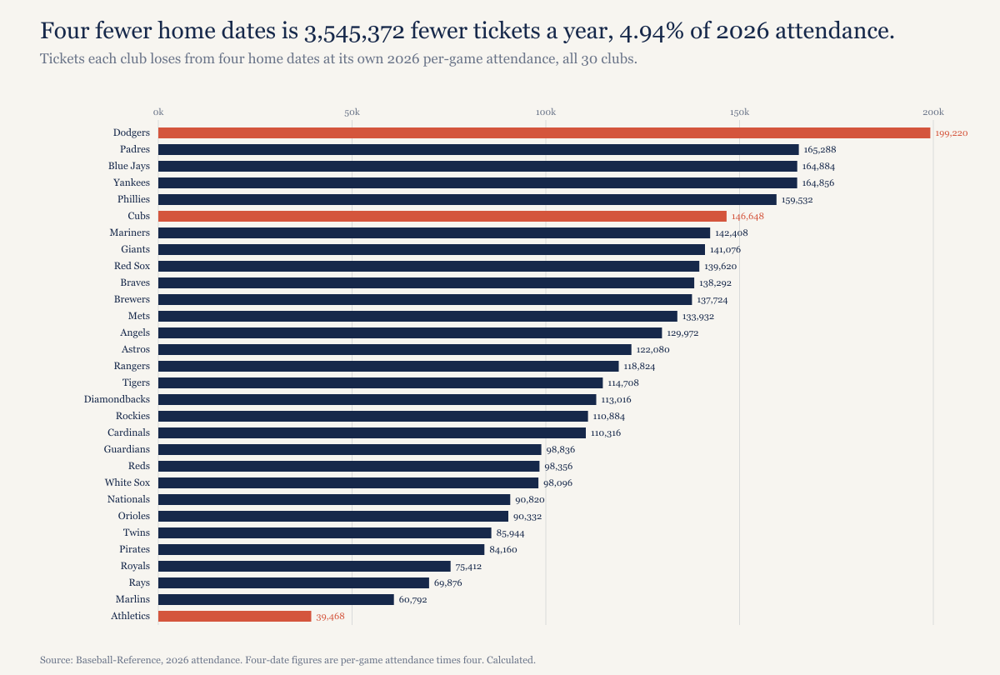
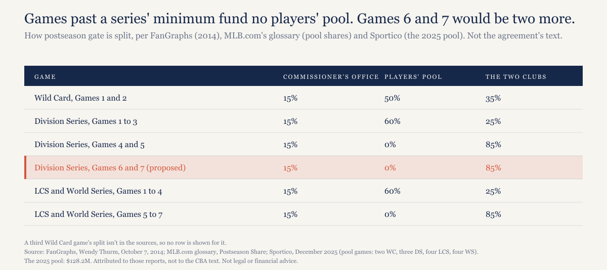
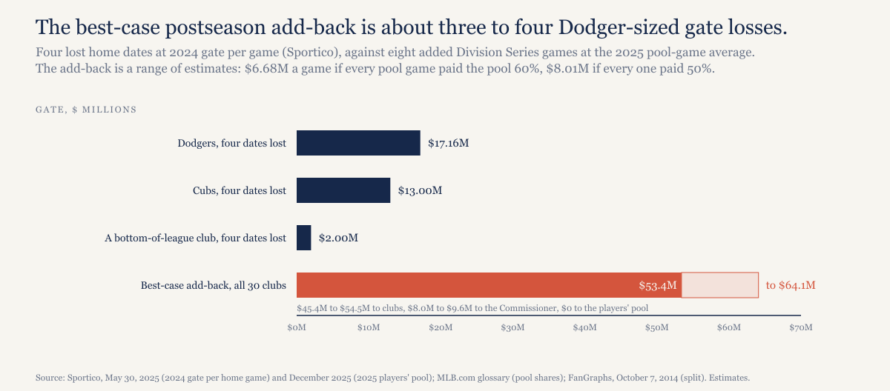
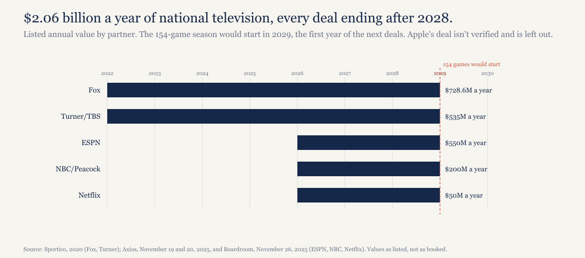

# Eight fewer games is 3.5 million fewer tickets. The money that pays for the cut isn't at the gate.

*MLB's 154-game proposal trades local gate, which clubs share with each other at 48%, for national television inventory and postseason games, which the league sells centrally. The postseason add-back is small. The television money is the point, and every national deal expires the year before the shorter season would start.*

---

*Construction note. Attendance is Baseball-Reference's 2026 count for all 30 clubs. Gate per home game is from MLB's internal 2024 gate report as Sportico described it, which gives the top five clubs and a figure of about $500,000 at the bottom and no league total; I don't invent one. The postseason split is as FanGraphs described the CBA's rules in 2014, as MLB.com's glossary states the pool's shares, and as Sportico described the 2025 players' pool, not from the agreement's text, which I couldn't reach. Television values are the listed annual figures for five national deals; Apple's deal isn't verified and is left out. Every number is recomputed from the data files by model/recompute.py. Estimates are labeled, and so are judgments. None of this is legal or financial advice.*

*Disclosure: I held Cubs season tickets from 1998 to 2021.*

---

## What was proposed

On October 8, 2026, MLB proposed cutting the regular season from 162 games to 154 starting in 2029, adding a Monday national television window, expanding the Division Series to best-of-seven, and letting top seeds pick their opponents from 2027, all of it contingent on a salary cap. Salaries wouldn't be cut; bonus and option thresholds would be prorated. The season would end a week earlier. That's the proposal as MLB.com, the AP and Forbes reported it that day, and as the players' association answered it: every piece of it is tied to the cap.

Eight games a season is four home dates per club. The question here is who gives up what, and who gets what, when those four home dates go away.

## What the gate loses

Start with the tickets. The 30 clubs drew 71,752,722 fans in 2026, 29,540 a game over 2,429 home dates. Take four dates from every club at its own 2026 per-game average and the league loses 3,545,372 tickets a season, 4.94% of this year's count. The Dodgers lose the most, 199,220 tickets; the Athletics the fewest, 39,468.

*[Caption: figures/captions.md, fig-01-tickets-lost]*

In dollars, the only per-game gate figures on the record are the ones Sportico reported from MLB's own 2024 gate report: the Dodgers at $4.29 million a home game, the Yankees $4.11 million, the Cubs $3.25 million, the Red Sox $2.93 million, the Astros $2.69 million, and "around $500,000" at the bottom of the league. Four dates, then, is about $17.16 million of gate for the Dodgers, $16.44 million for the Yankees, $13.00 million for the Cubs, $11.72 million for the Red Sox, $10.76 million for the Astros, and about $2.00 million for the cheapest clubs, in 2024 dollars and before concessions and parking. There's no published league total, so I can't put the 3.5 million tickets in dollars for the league as a whole, and I won't guess.

Gate is local revenue, and under the current agreement each club pools 48% of its net local revenue with the others. So a club that loses $17 million at the gate doesn't lose $17 million of its own money; it loses the share it would have kept after the pool, and the pool shrinks for everyone.

## What the postseason adds

The proposal's add-back is a best-of-seven Division Series, up to eight more postseason games a year, two in each of four series. What those games are worth depends on a rule most fans don't know.

The players' postseason pool is funded from only the minimum games in each series: two Wild Card games, three Division Series games, four each in the League Championship Series and World Series, 32 games in 2025. MLB.com's glossary gives the shares: 50% of the gate from the Wild Card games, 60% from the first three Division Series games and the first four of each LCS and the World Series. That pool was $128.2 million in 2025, as Sportico reported in December. Games beyond the minimum fund no pool at all. FanGraphs, describing the CBA's rules in 2014, gave the rest of the split: the Commissioner's Office takes 15% of all postseason gate; in a Wild Card game, 50% goes to the players' pool and 35% to the two clubs; in Games 1 through 3 of a Division Series, 60% to the pool and 25% to the clubs; from Game 4 on, 0% to the pool and 85% to the clubs. I'm attributing that to FanGraphs, MLB.com and Sportico rather than to the agreement itself, which I couldn't read.

*[Caption: figures/captions.md, fig-03-postseason-split]*

Size it. One pool figure and two pool shares don't give a single gate number, so I bound it. If every pool game paid 60%, a $128.2 million pool implies $213.7 million of gate across the 32 pool games, about $6.68 million a game; if every pool game paid 50%, $256.4 million and about $8.01 million a game. The truth sits between, since 8 of the 32 were Wild Card games at 50%. Both are estimates, averages across rounds; a Division Series game draws less than a World Series game. Eight added Division Series games at those averages is $53.4 million to $64.1 million of gate, and only if all four series go the distance, which they won't every year. Under the current split, $45.4 million to $54.5 million of that goes to the clubs, $8.0 million to $9.6 million to the Commissioner's Office, and nothing to the players' pool, unless the rule changes.

*[Caption: figures/captions.md, fig-02-lose-vs-add]*

Put the two side by side. The best case for the postseason add-back, every series going seven, is $53.4 million to $64.1 million for all 30 clubs together. The Dodgers' four lost dates alone are $17.16 million. The whole league's best-case add-back is about three to four Dodger-sized losses. The gate doesn't pay for the cut.

## What pays for it

Television does, or is meant to. The five national deals on the record run to $2,063.6 million a year: Fox at $728.6 million, Turner at $535 million, ESPN at about $550 million, NBC at about $200 million, and Netflix at about $50 million, the last three signed for 2026 through 2028. Apple's deal isn't verified, so it's not in that figure. Every one of the five expires after 2028. The 154-game season would start in 2029, with a new Monday national window to sell and, as Boardroom reported in November 2025, "every single possible game up for bid."

*[Caption: figures/captions.md, fig-04-tv-deals]*

National television money is split equally among the 30 clubs, as Mike Axisa at CBS Sports noted on October 8. That's the trade in one sentence: local gate, shared at 48%, for national rights, shared at 100%. A club like the Athletics gives up 39,468 tickets and gets a thirtieth of whatever a Monday window sells for. A club like the Dodgers gives up 199,220 tickets and gets the same thirtieth.

What a Monday window is worth, nobody has reported. I looked and found no figure, and I'm not going to estimate one.

## The counterargument, and the fan

Axisa raises the obvious reply: clubs could raise prices on the 77 dates that remain and make the gate whole. They could. Nobody has said what plan prices will do, and the one contract line I've read closely says something else. Last week I went through all 30 clubs' public season-ticket terms; the Cubs' turn on whether 41 home games are played. On 81 home dates, 40 games can be canceled with no refund owed under that clause. On 77, it's 36. The schedule shrinks, the contract's line doesn't move, and the holder's plan simply has four fewer games in it. [That piece is here.](https://ledgerandwhistle.substack.com/p/four-mlb-teams-season-ticket-contracts)

The players keep their salaries over fewer games, which works out to 5.2% more pay per game played, and they gain rest days. They also get a proposal that's contingent on a cap they've said they won't accept.

## The history

The 154-game season was the standard from 1904 through 1960, per SABR's account of schedule changes; 162 arrived with expansion, in the American League in 1961 and the National League in 1962. In 1946, owners floated 168 games, partly to pay for pension concessions to the players, and dropped it after what SABR calls "heavy opposition from the public and the players."

The closer precedent is five years old. In early 2021, MLB proposed a 154-game season starting about a month late, with players paid as if they'd played all 162, plus an expanded postseason. The union rejected it within days, objecting among other things to being asked to accept expanded playoffs it had already turned down, as CBS Sports reported on February 2, 2021. Fewer regular-season games, full pay, more October: the shape of the trade is the same as this one. The difference now is the price tag attached to it, a salary cap.

## What would make this wrong

The gate figures are 2024 per-game numbers for five clubs and a rounded floor for the rest, applied to 2026 attendance. A league total would make the comparison cleaner, and none is published.

The postseason split is as FanGraphs described it in 2014, MLB.com's glossary describes it now, and Sportico described the 2025 pool. If the current agreement has changed the pool rules, or the proposal changes them, the $0 to the players' pool is wrong and the add-back shifts.

The $6.68 million to $8.01 million a game is a range of averages across rounds, not a measured Division Series gate. Division Series games draw less than World Series games, so eight added Division Series games are probably worth less than $53.4 million, let alone $64.1 million, even in the best case.

The television figures are listed annual values, not what MLB books, and Apple is missing. If the 2029 deals come in far above $2.06 billion, the cut pays for itself many times over and the gate arithmetic is a footnote. That's a judgment about where the money is, and the point of the piece.

Prices on the 77 dates could rise enough to cover the four lost ones. No club has said so.

## What this predicts

Two calls, both checkable when the next labor agreement's terms are published.

First, if the new agreement includes a best-of-seven Division Series, Games 4 through 7 still fund no players' pool. The added October gate goes to the clubs and the Commissioner's Office, as it does for Games 4 and 5 now.

Second, if the new agreement shortens the schedule, the shorter schedule starts no earlier than 2029, the first season of the next national television deals.

## The data

Four files and a script, in [`mlb-154-games-2026/`](https://github.com/mgag70-prog/hqsports-research/tree/main/mlb-154-games-2026): `data/attendance-2026-bref.csv` (Baseball-Reference, all 30 clubs, with the four-date loss per club), `data/gate-per-game-2024-sportico.csv`, `data/postseason-gate.csv` (Sportico, December 2025; FanGraphs, Wendy Thurm, October 7, 2014; [MLB.com glossary, "Postseason Share"](https://www.mlb.com/glossary/miscellaneous/postseason-share)) and `data/national-tv-deals.csv` (Sportico 2020; Axios, November 19 and 20, 2025; Boardroom, Shlomo Sprung, November 26, 2025). `model/recompute.py` recomputes every figure above and fails on a mismatch. The proposal: MLB.com (Mark Feinsand), the AP and Forbes (Maury Brown), October 8, 2026; the equal split of national money and the pricing counterargument: CBS Sports (Mike Axisa), October 8, 2026; schedule history: SABR, "Schedule Changes Since 1876"; the 2021 proposal: CBS Sports (Mike Axisa and Katherine Acquavella), February 2, 2021.

---

## Not for publication

Alternate titles:

1. MLB wants to cut eight games. The gate can't pay for it, and the postseason barely helps. Television does.
2. 154 games, 3.5 million fewer tickets, and a Monday window nobody has priced.

Open items: no league-total gate figure exists in the sources; the Monday window has no reported value; the postseason split rests on FanGraphs 2014, the MLB.com glossary and Sportico 2025, not the CBA text; the add-back is a range because the pool takes 50% of Wild Card gate and 60% of the rest, and no source gives the Wild Card gate separately; a third Wild Card game's split isn't in the sources; Apple's deal is unverified and excluded; the 1961-62 revenue motive has no solid source beyond SABR's line on expansion.
