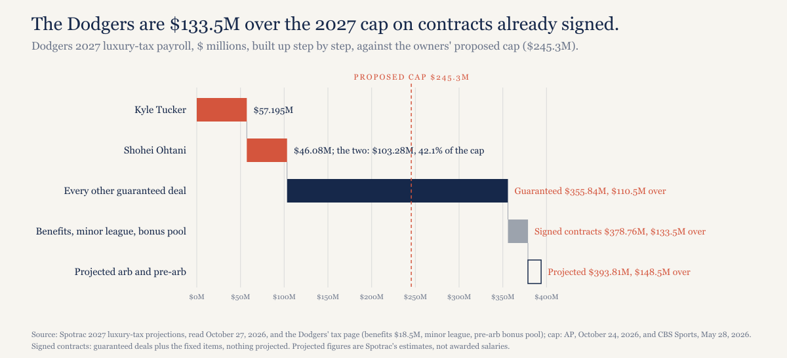
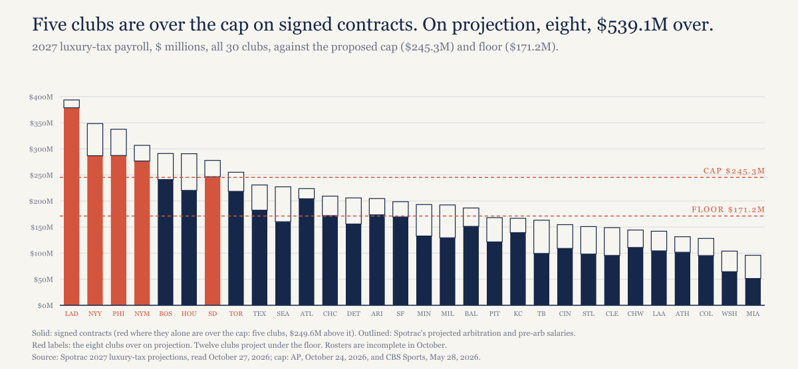
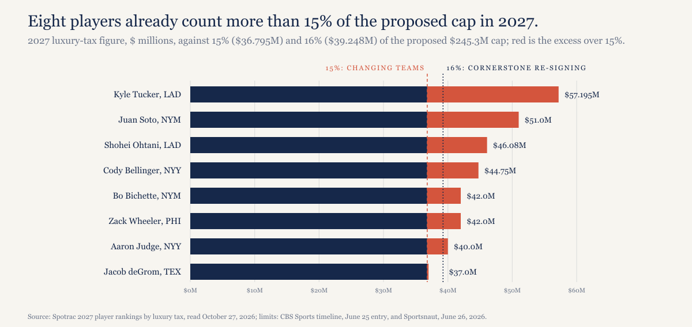
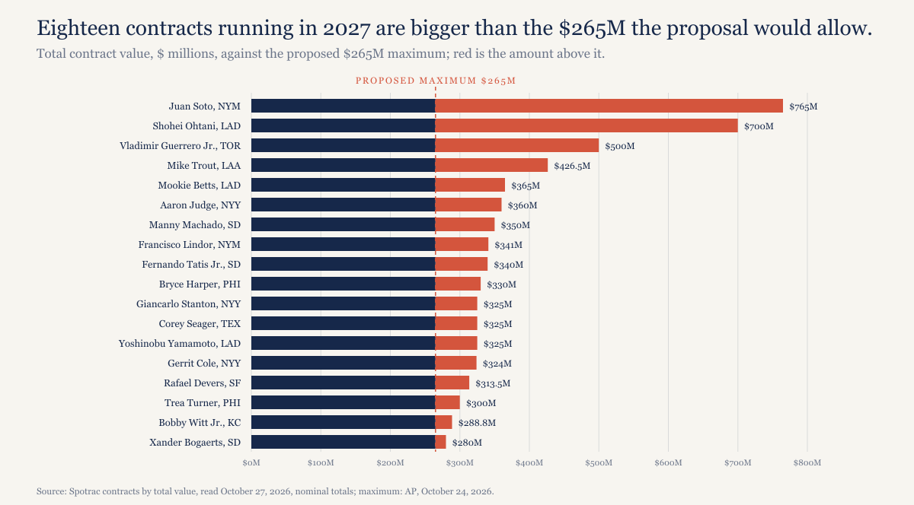

# The Dodgers are already $133 million over a 2027 salary cap, before they sign anyone.

*The owners' proposed 2027 cap is $245.3 million. On contracts already signed, five clubs are over it. Add the arbitration and pre-arbitration salaries Spotrac projects and it's eight, a combined $539.1 million over, before a single free agent signs this winter.*

---

## The Dodgers

Start with the guaranteed contracts and nothing else. The Dodgers have $355.84 million of signed deals on the 2027 books, $110.5 million over a $245.3 million cap before anyone counts a dollar of benefits. Spotrac then adds what every club carries: $18.5 million of player benefits, $2.75 million of minor league salaries and a $1,666,666 bonus pool for pre-arbitration players. On signed contracts the Dodgers are at $378.76 million, $133.5 million over. Projected, with Spotrac's arbitration and pre-arbitration estimates, they're at $393.81 million, $148.5 million over.

*[Caption: figures/captions.md, fig-01-dodgers-stack]*

Two contracts carry a lot of it. Kyle Tucker counts $57.195 million against the 2027 tax payroll. Shohei Ohtani counts $46.08 million, the luxury-tax value of a contract Spotrac lists at $70 million a year, discounted because so much of the money is deferred. Together that's $103.28 million, 42.1% of the cap for two players, and Tucker alone is 23.3% of it.

## Everyone over the line

On signed contracts alone, five clubs are over the cap: the Dodgers by $133.5 million, the Phillies by $42.0 million, the Yankees by $41.6 million, the Mets by $31.5 million and the Padres by $1.2 million, $249.6 million over in all. Projected payrolls bring in Boston ($45.8 million over), Houston ($45.4 million) and Toronto ($9.9 million), which makes eight clubs and $539.1 million. The Yankees' gap more than doubles on projection, to $103.1 million, because Spotrac expects them to pay $51.55 million in arbitration salaries.

Over the cap and before the offseason. Every one of those figures comes before a single free agent signs this winter.

*[Caption: figures/captions.md, fig-02-all-30]*

Eight is also MLB's number. Pitcher List reported in June that MLB said eight clubs' payrolls would decrease under the cap. MLB didn't publish its basis or name the clubs, so I can't tell you they're the same eight; the counts match and that's all I can say.

## Contracts the proposal wouldn't allow

What the owners proposed for individual contracts in June, as CBS Sports, AP and Sportsnaut described it: a free agent changing teams could get five years at most, starting at 15% of the cap, which comes to $202 million at the 2027 figure. A club re-signing what the proposal calls a "Cornerstone Player" could go six years starting at 16%, and AP put the largest contract the proposal allows at $265 million. Raises would be capped at 5% a year, deferrals banned on new deals, and the limits would apply to free-agent years only.

At a $245.3 million cap, 15% is $36.795 million and 16% is $39.248 million. Eight players already count more than the lower figure in 2027: Tucker ($57.195 million), Juan Soto ($51.0 million), Ohtani ($46.08 million), Cody Bellinger ($44.75 million), Bo Bichette and Zack Wheeler ($42.0 million each), Aaron Judge ($40.0 million) and Jacob deGrom ($37.0 million). Seven are over the higher one too; deGrom is the exception.

*[Caption: figures/captions.md, fig-03-over-max]*

Then there's length. Eighteen contracts still running in 2027 are worth more in total than $265 million, and Soto's $765 million is 2.9 times that. The Dodgers, Yankees and Padres hold three of the eighteen each. One belongs to Kansas City, Bobby Witt Jr.'s $288.8 million, which is a reminder that the biggest deals aren't only a big-market habit.

*[Caption: figures/captions.md, fig-04-over-265]*

None of this means those deals would be torn up. Sportsnaut reported that existing deferrals like Ohtani's would be grandfathered, and the max rules as described cover new free-agent contracts. What happens to everything else hasn't been said. Pitcher List put it plainly in June: "Not mentioned is what to do about teams like the Los Angeles Dodgers and New York Mets."

## The only precedent I can document

Hockey has one. The NHL came back from its cancelled 2004-05 season in July 2005 with a hard cap, and every existing contract was cut 24%, as I covered in the cap-valuations piece. The NFL's cap dates to 1994 and the NBA's to 1984, and both leagues also had contracts running when theirs arrived, but I haven't documented how they handled them, so the NHL is the only case here with an answer on the record.

I'm not predicting baseball copies it. The owners have three broad choices, and they haven't said which: grandfather the existing deals, so the cap doesn't bind the top clubs for years; roll salaries back, as hockey did; or make clubs trade or release players to get under. The first is the quiet one. The last would put a $133.5 million problem on the Dodgers' desk in the first winter.

## The bottom of the table

Twelve clubs project under the $171.2 million floor for 2027 as rosters stand in October. The Rays, at a projected $163.12 million, are $8.1 million under it; the Guardians, at $148.97 million, are $22.2 million under. The Brewers aren't on the list anymore. Their projected $192.41 million clears the floor, and $58.0 million of it is projected arbitration salaries; on signed contracts alone they're at $129.41 million.

That cuts against my floor piece rather than for it. I predicted that at least one of the Brewers, Rays or Guardians would raise its payroll in the first season under a floor to reach it. If the Brewers clear the floor on arbitration awards alone, the wording of that prediction is met without anything being tested, so I won't count Milwaukee if it happens.

## What the two sides have said

Bruce Meyer, the union's interim executive director, called the cap proposal a "nuclear bomb," AP reported on October 24. Rob Manfred, speaking before Game 1 about small-market clubs in the World Series, said "Once every 40 years is not enough," per RG, and told AP: "It's not that no small market can win, it's just that it's pretty rare." The agreement expires at 11:59 p.m. ET on December 1, 2026, and AP expects a lockout right after; spring training workouts are set for February 9, 2027, and Opening Day for March 24.

Going into Game 5, the Brewers lead the World Series three games to one. They won 3-2 in Milwaukee on October 23, 5-4 the next night and 10-1 on October 26, and the Rays stayed alive on October 27 with a 4-3 win in 12 innings. Game 5 is tonight, Wednesday, October 28, at 8 p.m. ET in Tampa Bay, between two clubs that were both under the owners' floor on 2026 payrolls.

## What would make this wrong

Spotrac's arbitration figures are its estimates. If arbitration awards come in lower, the projected count could fall back toward the five clubs over on signed contracts, though the Dodgers, Phillies, Yankees, Mets and Padres are over without any projection at all. The Padres are the soft one: $1.2 million over on signed contracts is a single trade.

The cap could move. $245.3 million is the owners' opening figure for 2027, not a negotiated one, and a higher number shrinks every gap here. It would have to rise past $378.76 million to clear the Dodgers on signed contracts alone.

And the basis is Spotrac's, not MLB's official competitive-balance-tax calculation, which comes later.

## What this predicts

If the next agreement includes a hard cap, based on what is being reported, it includes a transition rule for contracts signed before it (grandfathering, a phase-in or a rollback), and no club is forced to release a player to get under the cap in its first season. Checkable when the agreement's terms are published.

## About this piece

*Construction note. Payrolls are Spotrac's 2027 luxury-tax payrolls, read October 27, 2026, which include player benefits, minor league salaries and the pre-arbitration bonus pool; AP reported on October 24 that the owners' cap is "based on luxury tax payroll figures." Two measures run through the piece and each figure says which it is. Signed contracts means guaranteed deals plus those fixed items, with nothing projected. Projected adds Spotrac's estimates of arbitration and pre-arbitration salaries, which are estimates, not awarded salaries. October rosters are incomplete, so payrolls will rise, which only widens the gaps at the top. Nobody has said publicly how the proposal treats contracts already signed; this piece measures the problem, not the rule that would solve it. Every number is recomputed from the data files by model/recompute.py. Not legal or financial advice.*

*Disclosure: I held Cubs season tickets from 1998 to 2021. The Cubs' projected 2027 payroll is $209.35 million, $36.0 million under the cap.*

## Sources

- Spotrac, [2027 MLB team tax tracker](https://www.spotrac.com/mlb/tax/_/year/2027), read October 27, 2026
- Spotrac, [Dodgers 2027 luxury-tax breakdown](https://www.spotrac.com/mlb/los-angeles-dodgers/tax/_/year/2027)
- Spotrac, [2027 player rankings by luxury tax](https://www.spotrac.com/mlb/rankings/player/_/year/2027/sort/tax_total)
- Spotrac, [MLB contracts by total value](https://www.spotrac.com/mlb/contracts/sort-average/)
- AP (Ronald Blum), [Union head calls MLB's salary cap proposal 'nuclear bomb'](https://sports.yahoo.com/articles/union-head-calls-mlbs-salary-000141929.html), October 24, 2026
- RG (Sergey Demidov), [Manfred: Brewers-Rays series bolsters salary cap case](https://rg.org/news/baseball/rob-manfred-small-market-world-series-salary-cap-bruce-meyer-mlbpa), October 24, 2026
- CBS Sports, [MLB CBA negotiations timeline](https://www.cbssports.com/mlb/news/mlb-cba-negotiations-timeline-2026/)
- CBS Sports (Dayn Perry), [MLB officially proposes salary cap and floor](https://www.cbssports.com/mlb/news/mlb-proposes-salary-cap-floor-cba-negotiations-mlbpa/), May 28, 2026
- Pitcher List (Joe Landolina), [Analyzing MLB's salary cap proposal](https://pitcherlist.com/analyzing-mlbs-salary-cap-proposal-who-benefits/), June 5, 2026
- Sportsnaut (Isaac Ciravolo), [MLB's CBA proposal: hard caps, max contracts](https://sportsnaut.com/mlb/mlb-cba-proposal-salary-cap-max-contracts), June 26, 2026
- CBS Sports, [2026 MLB playoff bracket](https://www.cbssports.com/mlb/news/2026-mlb-playoff-bracket-schedule-scores-results-how-to-watch/)
- Data and checking script: [mlb-2027-cap-2026 on GitHub](https://github.com/mgag70-prog/hqsports-research/tree/main/mlb-2027-cap-2026)

---

## Not for publication

Alternate titles:

1. Five teams are over the owners' 2027 cap on contracts they've already signed.
2. Eight clubs, $539.1 million over a cap that doesn't exist yet.

Cover line (verbatim in "Everyone over the line"): Over the cap. Before the offseason.

Sources: Spotrac 2027 team tax tracker, payroll, AAV and cash tables, read October 27, 2026 (https://www.spotrac.com/mlb/tax/_/year/2027); Spotrac Dodgers, Mets and Yankees 2027 tax pages for benefits, minor league and the bonus pool (https://www.spotrac.com/mlb/los-angeles-dodgers/tax/_/year/2027); Spotrac 2027 player rankings by luxury tax (https://www.spotrac.com/mlb/rankings/player/_/year/2027/sort/tax_total); Spotrac contracts by total value, nominal AAV (https://www.spotrac.com/mlb/contracts/sort-average/); AP (Ronald Blum), October 24, 2026 (https://sports.yahoo.com/articles/union-head-calls-mlbs-salary-000141929.html); RG (Sergey Demidov), October 24, 2026 (https://rg.org/news/baseball/rob-manfred-small-market-world-series-salary-cap-bruce-meyer-mlbpa); CBS Sports CBA timeline, June 25 entry (https://www.cbssports.com/mlb/news/mlb-cba-negotiations-timeline-2026/); CBS Sports, May 28, 2026 (https://www.cbssports.com/mlb/news/mlb-proposes-salary-cap-floor-cba-negotiations-mlbpa/); Pitcher List (Joe Landolina), June 5, 2026 (https://pitcherlist.com/analyzing-mlbs-salary-cap-proposal-who-benefits/); Sportsnaut (Isaac Ciravolo), June 26, 2026 (https://sportsnaut.com/mlb/mlb-cba-proposal-salary-cap-max-contracts); NBC Chicago/AP on Game 1 (https://www.nbcchicago.com/mlb/brewers-win-game-1-world-series-rays/4006837/); CBS Sports bracket for Games 1 to 4 and the Game 5 time (https://www.cbssports.com/mlb/news/2026-mlb-playoff-bracket-schedule-scores-results-how-to-watch/); prior pieces mlb-floor-2026 and mlb-cap-valuations-2026 (NHL 2005, the 24% rollback, the NFL and NBA cap dates).

Open items:

- The World Series paragraph is written as of going into Game 5 (CBS Sports bracket). If publication slips past tonight's game, it needs another update.
- The Phillies' signed-contracts gap is $42.0 million, not the outline's $41.9 million: the exact figure is $41.95 million and the outline rounded the payroll before subtracting.
- The outline called the NHL "the one time a major league put a cap over contracts already signed." The files don't support that against the NFL (1994) and NBA (1984), so the draft says it's the only case with a documented answer.
- The outline credited Pitcher List with guessing that grandfathering means the cap doesn't bite for years. That guess isn't in context.csv or sources.md, so the draft lists grandfathering as an option without attributing it.
- AP words the individual limit as no player taking "more than 15% of a team's payroll"; CBS words it as 15% of the cap. The draft uses the cap version, which is what makes the $36.795 million line.
- MLB's "eight clubs" is via Pitcher List, not MLB directly, and its basis isn't public.
- "Spotrac lists at $70 million a year" is Spotrac's nominal AAV for Ohtani; Tucker's nominal AAV there is $60 million and isn't used.
