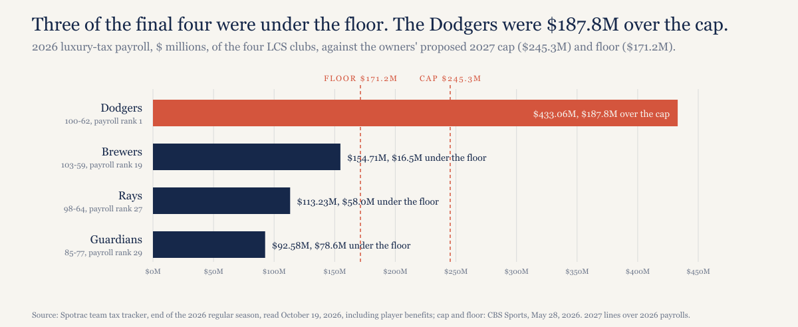
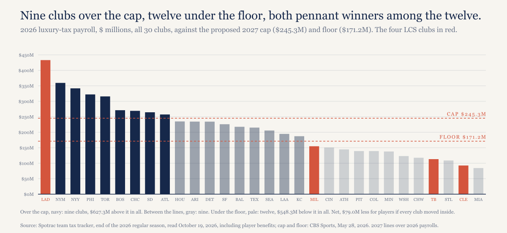
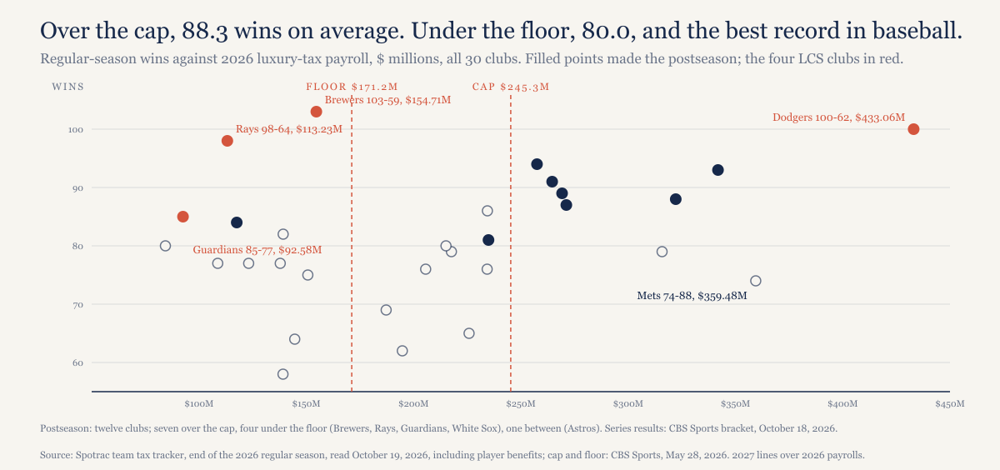
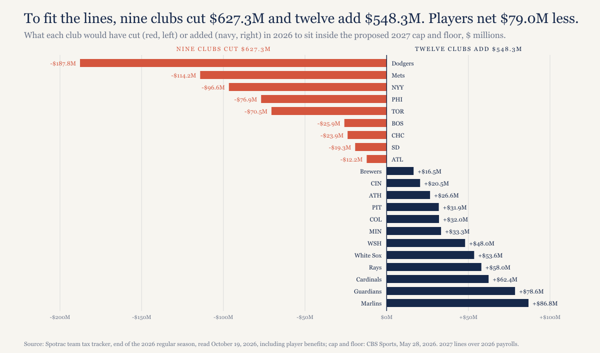

# Baseball's best team would have been under the owners' salary floor.

*On May 28 the owners proposed a $245.3 million cap and a $171.2 million floor for 2027. Measured against 2026 payrolls, the Brewers, baseball's best team at 103-59, were $16.5 million under that floor. The Rays (98-64) were $58.0 million under it. The Dodgers, the team the Brewers swept, were $187.8 million over the cap.*

---

*Construction note. Payrolls are Spotrac's 2026 luxury-tax payrolls at the end of the regular season, read October 19. They include player benefits, an $18,000,000 line on Spotrac's team tax pages, which puts them on the same basis as the owners' lines, which CBS reported "including benefits expenses." The cap and floor are 2027 figures; laying them over 2026 payrolls is an illustration, not a forecast of what anyone will spend next year, and the proposal ties the cap to 50% of revenue, so both lines would move. Every number is recomputed from the data files by model/recompute.py. Not legal or financial advice.*

*Disclosure: I held Cubs season tickets from 1998 to 2021. The Cubs are one of the nine clubs over the cap here, at $269.22 million.*

---

## The final four, against the lines

Two lines went on the table on May 28: a cap of $245.3 million and a floor of $171.2 million, both for 2027 and both counted with player benefits in. Lay them over this year's payrolls and the four teams left in October split like this. The Dodgers spent $433.06 million, the most in baseball, $187.8 million over the cap. The Brewers, who swept them, spent $154.71 million, 19th of 30, $16.5 million under the floor. The Rays spent $113.23 million, 27th, $58.0 million under it; the Guardians $92.58 million, 29th, $78.6 million under. The Dodgers' payroll is $72.5 million more than the other three combined.

*[Caption: figures/captions.md, fig-01-final-four]*

The Brewers beat the two-time defending champions four games to none between October 11th and 15th, the first National League pennant in the franchise's history, as MLB.com reported on October 16th. The American League took longer. The Rays beat the Guardians 7-3 in Game 6 at Tropicana Field on October 19th and won the series four games to two, the franchise's third pennant after World Series losses in 2008 and 2020. Both pennant winners were under the owners' floor. Add the two World Series payrolls together and you get $267.94 million, $165.1 million less than the Dodgers' $433.06 million on its own.

Under the floor. In the World Series. Game 1 is Friday, October 23, in Milwaukee.

## All 30 clubs

Nine clubs were over the cap, twelve were under the floor, and nine sat between the lines. To bring everyone inside them, the nine over the cap would cut $627.3 million and the twelve under the floor would add $548.3 million, so players as a group would be paid $79.0 million less than they were this year.

*[Caption: figures/captions.md, fig-02-all-30]*

Three other figures for that net number are in circulation, and they don't agree with each other or with mine. MLB has said its numbers show players gaining $39 million across the 30 clubs, in a Yahoo Sports video from October 1st. The union's Bruce Meyer said in June that players would lose more than $500 million on 2026 figures, per CBS Sports' bargaining timeline. CBS's own estimate on May 28, from Cot's early-season numbers, was a cut of $18.7 million; its count of clubs over and under, 9 and 12, is the same as mine. The difference between an $18.7 million cut in May and a $79.0 million cut in October is what five months of trades, injuries and call-ups did to payrolls. I can't tell you how MLB got to a gain, because MLB hasn't shown the arithmetic.

## Spending still buys wins, on average

Say the honest thing first. The nine over-cap clubs averaged 88.3 wins; the twelve under the floor averaged 80.0. Money buys wins on average, and a chart with a cap line on it shouldn't pretend otherwise. The Mets are the other half of that lesson: the second-highest payroll in baseball, $359.48 million, a 74-88 record, and no October.

*[Caption: figures/captions.md, fig-03-wins-vs-payroll]*

What's odd about 2026 is the top of the standings. The best record in baseball, Milwaukee's 103-59, belonged to a club under the floor, and so did the third-best, Tampa Bay's 98-64, with the Dodgers' 100-62 between them. Of the twelve playoff clubs, seven were over the cap, four were under the floor (the Brewers, Rays, Guardians and White Sox) and one, Houston, was in between. And every October series that matched an under-floor club against an over-cap club went to the under-floor club: Rays over Yankees in the Division Series, Brewers over Padres in the other one, Brewers over Dodgers for the pennant.

That's three series. Three series prove nothing about a cap, which CBS's Matt Snyder said on October 13 and which I'd say just as readily if the three had gone the other way. The 88.3 and the 80.0 are the better evidence, and they point the other direction.

## What a floor does

The floor is the part of the proposal that sounds like it's for the players, and the owners sell the pair as competitive balance; MLB's own social accounts have been making that case since July. Look at who the floor touches. It's a spending requirement on the cheapest clubs, and the four cheapest this year were the Rays, Cardinals, Guardians and Marlins. To reach $171.2 million they would have needed to add $58.0 million, $62.4 million, $78.6 million and $86.8 million. Two of those four played for a pennant.

*[Caption: figures/captions.md, fig-04-change-to-comply]*

The cap does the cutting, and it's the bigger number: $627.3 million out of nine clubs, against $548.3 million into twelve. The two lines are sold together and they land on different clubs. The floor would have told the Brewers to spend $16.5 million more on a team that won 103 games. The cap would have told the Dodgers to spend $187.8 million less on one that won 100 and lost the pennant in four.

## What would make this wrong

The lines are 2027 numbers over 2026 payrolls. The owners' proposal sets the cap from revenue, so a 2027 floor could land somewhere other than $171.2 million; if it lands below $154.71 million, the Brewers' line in this piece goes away. That's the biggest single risk here.

The payroll basis could be off. Spotrac counts $18,000,000 of benefits per club; CBS's May estimate used about $23 million. If the true benefits figure is $5 million higher, every payroll here moves up by $5 million and the Brewers are still under the floor by about $11.5 million. For the four final-four clubs, Spotrac's figures sit within $1 million of the MLB figures CBS published on October 13; I haven't cross-checked the other 26.

MLB's $39 million and the union's $500 million are each side's number, built on bases I can't see. Mine is end-of-season Spotrac; it isn't the official competitive-balance-tax calculation, which MLB publishes later.

Three series between under-floor and over-cap clubs is a coin flipped three times.

## What this predicts

If the next agreement includes a cap and a floor, at least one of the Brewers, Rays or Guardians raises its payroll in the first season under it to reach the floor. Checkable when the agreement's terms and that season's tax payrolls are published.

## The data

Five files and a script, in [`mlb-floor-2026/`](https://github.com/mgag70-prog/hqsports-research/tree/main/mlb-floor-2026): `data/spotrac-tax-by-season.csv` (Spotrac's team tax tracker, 2011 through 2026, fetched October 19, 2026), `data/postseason-2026.csv` (the bracket as CBS Sports showed it on October 18, with the ALCS result from AP and ESPN after Game 6 on October 19), `data/context.csv` (the cap and floor, the competing net-change figures, the series results, each with its source), `data/2026-vs-cap-floor.csv` (the comparison, written by the script) and `data/sources.md`. `model/recompute.py` recomputes every figure above and fails on a mismatch. The proposal: CBS Sports (Dayn Perry), May 28, 2026. MLB's figure: Yahoo Sports, October 1, 2026. The union's: CBS Sports' bargaining timeline, June 1 entry. The final-four payrolls and the "one October" point: CBS Sports (Matt Snyder), October 13, 2026. The NLCS: MLB.com (AJ Cassavell), October 16, 2026. The ALCS: AP via TSN and ESPN, after Game 6 on October 19. Benefits: Spotrac's Rays tax page; CBS Sports, May 28, 2026.

---

## Not for publication

Alternate titles:

1. The Brewers won 103 games and a pennant on a payroll the owners want to make illegal.
2. Both pennant winners were under the owners' floor. The Dodgers were $187.8 million over the cap.

Open items: the competitive-balance pitch is attributed to MLB's social accounts (NY Post via Yahoo, July 4) and not to Manfred by name, since no Manfred quote is in the files; MLB's $39 million comes from a video and I've paraphrased it; the union's figure is paraphrased from CBS's timeline, not quoted; the $11.5 million is 16.5 minus the $5 million benefits gap, labeled "about".
