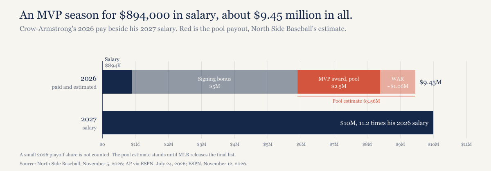
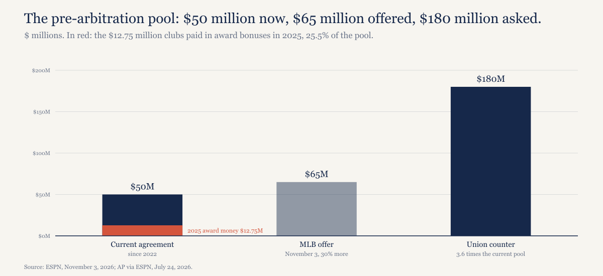

# Pete Crow-Armstrong was paid $894,000 to win the MVP. The bonus comes from a pool both sides are fighting over.

*The MVP adds $2.5 million from baseball's pre-arbitration pool. MLB offered to grow the pool to $65 million; the union wants $180 million.*

---

## The vote

Pete Crow-Armstrong won the National League MVP unanimously Thursday night with all 30 first-place votes, Jesse Rogers reported for ESPN. Shohei Ohtani finished second and Brice Turang third. Crow-Armstrong hit .280/.372/.570 with 45 home runs and 41 stolen bases, and he's the Cubs' first MVP since Kris Bryant in 2016. Yordan Alvarez won the American League award unanimously as well, and with both Cy Young votes also unanimous, ESPN called it "the first season in which both MVP winners and both Cy Young winners were unanimous."

I went through what the season does to the value of his contract [in September](https://ledgerandwhistle.substack.com/p/if-pete-crow-armstrong-were-still). This piece follows a smaller check that arrives much sooner.

## What the award pays, and who pays it

He played 2026 for $894,000, which is $114,000 above the $780,000 league minimum. The six-year, $115 million extension he signed in March doesn't start until 2027, so his MVP season ran at the pre-arbitration rate, the same pay he'd have drawn with no extension at all.

The MVP pays him anyway, just not through the Cubs' payroll. It triggers $2.5 million from the pre-arbitration bonus pool, the $50 million fund the 2022 labor deal created to get money to players too junior for arbitration. Every club pays in roughly $1.67 million, and players who've signed early extensions still collect, MLB Trade Rumors reported when the 2025 list came out. That $2.5 million alone is 2.8 times his salary.

Awards come off the top. What's left gets split among the top 100 pre-arbitration players by a joint FanGraphs and Baseball Reference WAR, and his 10.2 jWAR is 3.2% of that group's total. Matthew Trueblood of North Side Baseball ran the numbers on November 5 and got around $3.56 million: the MVP's $2.5 million plus a bit over $1 million for WAR. MLB hasn't released the final list, so treat that as North Side Baseball's estimate until it does. If it holds, the payout is 4.0 times his salary and 7.1% of the whole pool, about 3.0 times the $1,206,207 he drew from it in 2025, and about $120,000 more than Paul Skenes's record $3,436,343 last year.

So who writes the check? All 30 clubs do, in roughly equal shares. On MLB Trade Rumors' figure of roughly $1.67 million a club, the Cubs' part of his payout is about one-thirtieth, roughly $119,000, and the other 29 clubs cover the rest. That's the odd part of the arrangement: the Cubs signed the extension, and the Pirates, Brewers and Cardinals help pay his MVP bonus.

Add the pool money to his salary and the $5 million signing bonus, and his 2026 pay comes to about $9.45 million, not counting a small playoff share. Next year his salary alone is $10 million, 11.2 times this year's.

$894,000. Most Valuable.

*[Caption: figures/captions.md, fig-01-pay-stack]*

## The pool is on the table

The agreement expires December 1, and the pool is one of the numbers the two sides are still apart on. MLB's November 3 offer raised it to $65 million, 30% more than now, Jeff Passan reported for ESPN; the union's counter is $180 million, 3.6 times the current pool. In July, the AP described the union's version as $180 million next year with $15 million annual increases. [Week 2 of the lockout countdown](https://ledgerandwhistle.substack.com/p/20-days-left-and-the-mlb-free-agent) has where the rest of the talks stand.

Award money already takes a big bite. Clubs paid $12.75 million in award bonuses in 2025, 25.5% of the $50 million, and Trueblood expects a record number of award bonuses this year, which leaves less for the WAR split. The MVP bonus by itself is 5.0% of the pool.

*[Caption: figures/captions.md, fig-02-pool]*

Neither side's proposal, as reported, says what an MVP would collect from a bigger pool, and I'm not going to guess. One union proposal cuts the other way for a player in his spot. The AP reported in July that the union wants players signed to multiyear contracts made ineligible starting next year. As I read that, an extended pre-arbitration player like Crow-Armstrong this season would get nothing from the pool, however large it grows.

## What the MVP starts on his contract

This year's award counts for none of his contract escalators. Those begin with 2027 voting: each MVP from 2027 through 2030 adds $2 million to his 2031 base, each from 2027 through 2031 adds $2 million to his 2032 base, and lower finishes bring smaller bumps. The most they can add is $8 million in 2031 and $10 million in 2032, which I put at $13.0 million in present value at 6% in the September piece. He can't draw from the pool again, either, because he leaves the pre-arbitration bracket after this season.

[The September 14 model](https://signalhunterai.substack.com/p/the-cubs-saved-29-million-on-pete) had 2027 as a $9.0 million loss for the Cubs against no extension, since they'd have controlled that season for close to the minimum. The later piece covered what the breakout does to the savings, and I won't redo either one here.

## The roster around him

Three of his teammates are free agents on MLB Trade Rumors' top 50: Seiya Suzuki (No. 4), Ian Happ (No. 17) and Shota Imanaga (No. 21). What the Cubs commit around an MVP still on a pre-arbitration salary is the next piece.

## What I expect

The next agreement's pre-arbitration pool lands below $122.5 million, the midpoint of the two offers, closer to MLB's $65 million than the union's $180 million. Checkable when the next agreement's terms are published.

## About this piece

*Construction note. The $3.56 million pool payout is North Side Baseball's estimate, published November 5, and stands until MLB releases the final 2026 list later this month; the split into $2.5 million for the award and about $1.06 million for WAR is arithmetic on that estimate. The Cubs' $119,000 is arithmetic on equal club contributions of roughly $1.67 million, as MLB Trade Rumors reports them, not a figure from the club. The $9.45 million for 2026 adds salary, signing bonus and the pool estimate and leaves out his playoff share. Every number is recomputed from the data files by model/recompute.py. Not legal or financial advice.*

*Disclosure: I held Cubs season tickets from 1998 to 2021.*

## Sources

- ESPN (Jesse Rogers), [Cubs' Pete Crow-Armstrong, Astros' Yordan Alvarez unanimous MVP winners](https://www.espn.com/mlb/story/_/id/50466186/cubs-pete-crow-armstrong-astros-yordan-alvarez-win-mvp-honors), November 12, 2026
- MLB.com (Theo DeRosa), [Here are the finalists for MVP, Cy Young, Rookie of the Year, more](https://www.mlb.com/news/2026-bbwaa-awards-finalists), November 9, 2026
- North Side Baseball (Matthew Trueblood), [Pete Crow-Armstrong Will Set a Pre-Arbitration Bonus Pool Earnings Record This Month](https://northsidebaseball.com/news-rumors/chicago-cubs/pete-crow-armstrong-will-set-a-pre-arbitration-bonus-pool-earnings-record-this-month-r3466/), November 5, 2026
- AP via ESPN, [Pete Crow-Armstrong leads 2026 MLB pre-arbitration bonus pool list](https://www.espn.com/mlb/story/_/id/49440234/2026-mlb-pre-arbitration-bonus-pool-list), July 24, 2026
- MLB Trade Rumors (Darragh McDonald), [Paul Skenes Tops 2025 Pre-Arbitration Bonus Pool](https://www.mlbtraderumors.com/2025/11/paul-skenes-tops-2025-pre-arbitration-bonus-pool.html), November 25, 2025
- ESPN (Jeff Passan), [MLB proposes delaying salary cap until 2028 season](https://www.espn.com/mlb/story/_/id/50370860/mlb-proposes-delaying-salary-cap-2028-season), November 3, 2026
- MLB Trade Rumors, [2026-27 Top 50 Free Agents With Predictions](https://www.mlbtraderumors.com/2026/11/2026-27-top-50-free-agents-with-predictions.html), November 2, 2026
- Signal Hunter, [The Cubs Saved $29 Million on Pete Crow-Armstrong, not $206 Million](https://signalhunterai.substack.com/p/the-cubs-saved-29-million-on-pete), September 14, 2026
- Ledger & Whistle, [If Pete Crow-Armstrong were still the 2025 player, his extension would break even. He isn't.](https://ledgerandwhistle.substack.com/p/if-pete-crow-armstrong-were-still), September 28, 2026
- Ledger & Whistle, [20 days left, and the MLB free-agent market has moved $11 million.](https://ledgerandwhistle.substack.com/p/20-days-left-and-the-mlb-free-agent), November 11, 2026
- Data and checking script: [pca-mvp-award-2026 on GitHub](https://github.com/mgag70-prog/hqsports-research/tree/main/pca-mvp-award-2026)

---

## Not for publication

Alternate titles:

1. Pete Crow-Armstrong's MVP pays him $2.5 million, and the Cubs cover about one-thirtieth of it.
2. The MVP who played for $894,000.

Cover line (verbatim in "What the award pays, and who pays it"): $894,000. Most Valuable.

Open items:

- "Third time both MVPs were unanimous": ESPN's November 12 story does carry a sidebar saying 2026 is "just the third time in MLB history where both MVP winners won unanimously." The draft uses only the line you asked for ("the first season in which both MVP winners and both Cy Young winners were unanimous").
- context.csv's unanimous_count (25 unanimous MVP winners, with him the latest) isn't in the ESPN story text, so the draft doesn't use it. ESPN does count him as the franchise's MVP number 13 and the first since Kris Bryant in 2016; the draft uses only the Bryant half, which needs no ordinal.
- Signal Hunter title: the outline has "...Crow-Armstrong. Not $206 Million."; the live page (curled November 13) reads "...Crow-Armstrong, not $206 Million". Sources uses the live title.
- MLB.com finalists date: published 02:32 UTC November 10, which is the evening of November 9 Eastern. Sources says November 9.
- New, sourced, not in the outline: the AP (July 24) reports the union proposed making players on multiyear contracts ineligible starting next year. The draft's read that this would shut out an extended pre-arb player like PCA is labeled as my reading.
- The "can't draw from the pool again" line is North Side Baseball's: "he'll no longer be in the pre-arbitration service time bracket."

RECHECK before publishing:

- Whether MLB/AP released the final 2026 pool list. If so, replace $3.56 million (and the 4.0x, 7.1%, 3.0x, $120,000, $119,000, $9.45 million and $1.06 million that follow from it) in context.csv, the draft, captions, figures and thread; recompute.py fails until they agree.
- Prediction: replace the [MATT TO CONFIRM] tag once confirmed; recompute.py's tag check flips with it.
