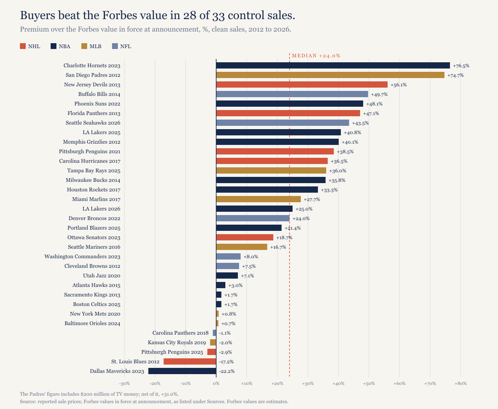
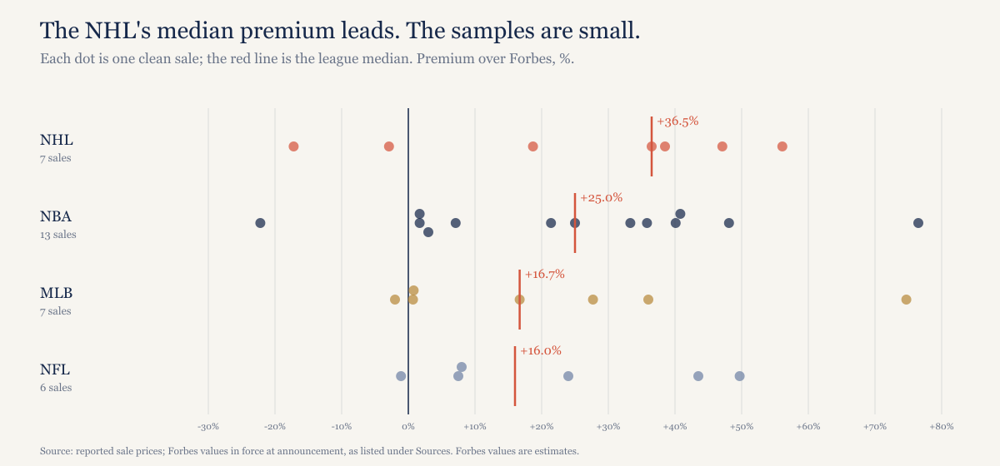
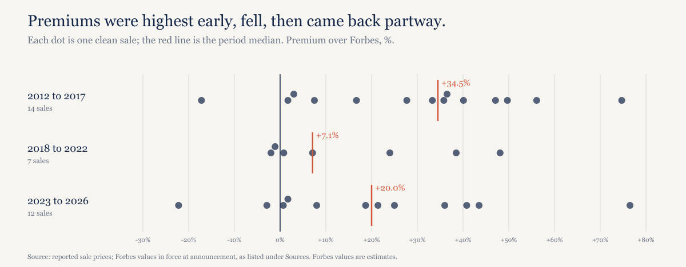

# The median buyer paid 24% more than Forbes said the team was worth. The trophy teams didn't get the biggest premiums.

*In 33 control sales since 2012, buyers paid a median 24.0% over Forbes. The Hornets drew 76.5%. The Celtics drew 1.7%.*

---

The argument goes like this - you can't build another Lakers, there are more billionaires than teams, and so when an elite club comes up the auction blows through any estimate. A reader sent me a version of it, and it's testable, because every sale has a price and Forbes publishes a value for every team. I pulled 47 control deals from 2011 through 2026 and set each one against the Forbes list in force when it was announced.

## The answer

Sold above the estimate. That's what happened in 28 of the 33 sales that survive my screen, and the other 5 went below. The median premium over Forbes is 24.0%. Add every deal together and buyers paid $89.56 billion against $74.07 billion of Forbes value, 20.9% more. The median deal itself is the Broncos, who went to the Walton-Penner group for $4.65 billion in 2022 against a Forbes $3.75 billion.

Forbes isn't usually far wrong in the other direction. Three of the 5 misses are within 3%: the Carolina Panthers in 2018 (1.1% under), the Royals in 2019 (2.0%) and the Penguins last December (2.9%). Only the Mavericks and Blues sold well below the estimate. Count both sides and 8 of the 33 landed within 3% of Forbes, which is a lot of near misses for a market supposedly running on frenzy.

A deal stays in if I found and checked both the price and the Forbes figure, nobody forced the sale, the league wasn't the seller, and control passed at a price set at the time. Put back every deal with both figures, 43 of them, and the median rises to 26.9%, so the screen pulls the answer down.

*[Caption: figures/captions.md, fig-01-premium-by-deal]*

Some of these prices are disputed, and the 24.0% moves with them. Take the lowest reported reading of every disputed deal and the median is 20.0%; take the highest and it's 25.0%. Drop the seven deals with arena or media assets in the price and it's 26.3% across 26. The result holds, but read it as "somewhere in the low to mid 20s."

## By league

The NHL leads at 36.5% on 7 sales, then the NBA at 25.0% on 13, MLB at 16.7% on 7 and the NFL at 16.0% on 6. Those are small samples, and one deal can move a median built on six or seven.

*[Caption: figures/captions.md, fig-02-by-league]*

My [cap piece](https://ledgerandwhistle.substack.com/p/baseballs-owners-want-a-salary-cap) looked at the owners' case that a cap lifts values. Here the 26 sales in the three capped leagues run a median 24.5%, above MLB's 16.7%, but the NFL sits just below baseball, so the capped leagues don't line up. A premium over Forbes also isn't a value. I wouldn't hang a cap argument on this in either direction.

## The trophy test

If scarcity drove the price, the rarest assets should clear the estimate by the most. Several didn't come close.

The Celtics went for $6.1 billion against a Forbes $6.0 billion, 1.7% over, and that's the first stage of a two-stage deal; Sportico later put the blended value near $6.5 billion, which would make it 8.3%. Steve Cohen paid $2.42 billion for the Mets against $2.4 billion, 0.8% over, or 3.1% on the $2.475 billion some outlets reported. The Commanders' record $6.05 billion beat Forbes by 8.0%. The Mavericks sold at $3.5 billion against $4.5 billion, 22.2% below, the steepest discount in the set.

The thesis does get two big wins. Mark Walter paid $10 billion for the Lakers in 2025 against $7.1 billion, 40.8% over, and the Khosla family's $9.612 billion for the Seahawks this July beat $6.7 billion by 43.5%. Then the Lakers sold again: $12.5 billion in August, a deal the NBA hadn't approved in my last check. The 25.0% premium on that one is soft, because Forbes' $10.0 billion was just Walter's own price, and first reports said more than $12 billion, which would make it 20.0%.

The top of the table looks nothing like a list of trophies. The Hornets lead at 76.5%, $3.0 billion against $1.7 billion. The Padres are second at 74.7%, overstated, because the $800 million included $200 million of TV money; net of that it's 31.0%. Then come the Devils at 56.1% with arena rights and debt in the deal, the Bills at 49.7% and the Suns at 48.1%.

Size barely matters. The 10 deals of $3 billion or more have a median of 24.5%, and the 23 below that 18.7%. All 10 came in 2022 or later, so that split is partly a calendar split. A little higher at the top, nothing like an auction frenzy.

## When it happened

The median was 34.5% from 2012 to 2017 on 14 sales, 7.1% from 2018 to 2022 on 7, and 20.0% from 2023 to 2026 on 12. Forbes may have caught up in the middle years. I can't show that from these numbers.

*[Caption: figures/captions.md, fig-03-by-period]*

Part of any premium is just the calendar. The median Forbes figure was 5.0 months old at announcement and the oldest 11.7. Sales measured against a list more than six months old ran 25.0% on 15 deals, and fresher ones 17.7% on 18.

## What I left out and why

Fourteen deals are out. Two were forced - the Clippers in 2014, $2.0 billion against $575 million, 247.8% over, after the NBA banned Donald Sterling, and the Dodgers in 2012, a bankruptcy auction with the stadium and land in the price.

Three had the league in the seller's chair. The NBA sold the Hornets in 2012, the NHL sold the Coyotes in 2013, and Utah's 2024 purchase of the Arizona hockey assets was a league-arranged transfer priced like an expansion fee.

Five were staged or set by an option. The Bucks in 2023 were a 25% stake. The Nets in 2019 closed at a price fixed by a 2018 option. Jeff Vinik keeps control of the Lightning for three years after the 2024 deal, and control of the Islanders, sold in 2014, passed only in 2016. The Timberwolves are the sharpest case of a buyer paying far less than Forbes: control passed in 2025 at the 2021 price of $1.5 billion, against Forbes' $3.1 billion, 51.6% below.

Four fell out on the record itself. The Jaguars and Pistons in 2011 predate the range, and the Pistons have no Forbes figure I could find. I couldn't find a price I trust for either Coyotes control deal, in 2014 or 2019.

## What stayed in, with an asterisk

Bundled assets inflate some premiums. The Jazz's $1.66 billion included the arena, the Mariners' $1.4 billion their ROOT Sports Northwest stake, the Hawks' $850 million included arena control, and the Blues' $130 million covered the arena lease, a minor-league club and more, which makes their 17.2% discount deeper on a team-only basis.

The Kings' 1.7% is measured against a Forbes figure that already priced in the Seattle bid; against the prior year's $300 million it's 78.0%. The Senators' 18.7% becomes 31.9% if the $950 million bought only the 90% stake. The Blazers' 21.4% is 17.1% on Sportico's later blended price. The Florida Panthers' $250 million came from an anonymous source.

Two prices are valuations rather than checks. The Mariners' $1.4 billion is Nintendo's stated value, with the actual price for its stake undisclosed, and the Hurricanes' 36.5% uses a $505 million valuation that Tom Dundon's 61% implied. AP measured that same sale against a stale $230 million from the prior year's list, which would make it 119.6%; I used the list that came out two days before the deal.

## What the 24% means

Forbes values are estimates, not prices. A 24.0% median gap says Forbes runs conservative on the teams that actually sell, and those are a selected group: clubs reach the market when an owner wants out and a buyer wants in. Nothing here tells you what the clubs that didn't sell would fetch.

Minority stakes aren't in the set either, and they generally price at a discount to control. So this isn't a claim that Forbes undervalues every team by a quarter, and it isn't a blank check for the scarcity story. Buyers do pay up for control. They just don't pay most for the names you'd guess.

## What I expect

The next NBA, NFL or MLB control sale announced after this piece clears the most recent Forbes value for that team. Checkable at the next announcement.

## About this piece

*Construction note. The set is 47 control deals announced from 2011 through 2026, each re-sourced in a second pass; 33 are clean. Premium is the reported price, or the implied value of 100% where a stake price was reported, divided by the Forbes value in force at announcement. Forbes.com was blocked to me, so most Forbes figures come from contemporaneous reports quoting the list or from Forbes' regional editions; a few rest on Wikipedia's table of the lists. Prices are reported figures, often from unnamed sources, and terms are rarely disclosed. Forbes values are estimates. Every number is recomputed from the data files by model/recompute.py. Not legal or financial advice.*

*Disclosure: I held Cubs season tickets from 1998 to 2021. The Cubs are not in the set.*

## Sources

Sale prices:

- SI, [Commissioner Bettman hails new owner of Blues](https://www.si.com/nhl/2012/05/10/new-stlouisbluesowner), May 10, 2012
- NBC Sports, [Sale of Grizzlies to Robert Pera finalized for $377 million](https://www.nbcsports.com/nba/news/sale-of-grizzlies-to-robert-pera-finalized-for-377-million), October 29, 2012
- AP via Bangor Daily News, [Cleveland Browns sold to Tennessee truck-stop magnate](https://www.bangordailynews.com/2012/08/02/sports/cleveland-browns-sold-to-tennessee-truck-stop-magnate/), August 2, 2012
- Ballpark Digest, [O'Malley group reaches agreement to buy Padres](https://ballparkdigest.com/201208075314/major-league-baseball/news/omalley-group-reaches-agreement-to-buy-padres), August 7, 2012
- SI, [Maloofs complete sale of Kings to Vivek Ranadive group at record valuation](https://www.si.com/nba/2013/05/31/sacramento-kings-sold-534-million-vivek-ranadive-george-maloof-joe-maloof-david-stern), May 31, 2013
- Fox News, [Devil of a deal: NHL franchise sold to Harris](https://www.foxnews.com/sports/devil-of-a-deal-nhl-franchise-sold-to-harris), August 15, 2013
- NBC Sports, [Official: Panthers sold to Vincent Viola for $250 million](https://www.nbcsports.com/nhl/news/official-panthers-sold-to-vincent-viola-for-230-million), September 27, 2013
- SI, [Bucks to be sold for $550 million, but will remain in Milwaukee](https://www.si.com/nba/point-forward/2014/04/16/milwaukee-bucks-sold-herb-kohl), April 16, 2014
- SI, [Buffalo Sabres owner Terry Pegula reaches deal to buy Bills](https://www.si.com/nfl/2014/09/09/buffalo-bills-sold-terry-pegula-buffalo-sabres), September 9, 2014
- theScore, [Hawks announce sale of franchise to Ressler-led group, reportedly for $850M](https://www.thescore.com/nfl/news/750793), April 22, 2015
- MLB.com press release, [Seattle Mariners ownership transition](https://www.mlb.com/press-release/seattle-mariners-ownership-transition-174917802), April 27, 2016
- CNN Wire via WTKR, [Nintendo sale of Mariners values team at $1.4 billion](https://www.wtkr.com/2016/04/27/nintendo-sale-of-mariners-values-team-at-1-4-billion), April 27, 2016
- AP via Boston.com, [Marlins plan to sell to group that includes Derek Jeter](https://www.boston.com/sports/mlb/2017/08/11/ap-source-marlins-plan-to-sell-to-group-that-includes-derek-jeter), August 11, 2017
- SI, [Reports: Rockets Sold to Houston Billionaire Tilman Fertitta for Record $2.2 Billion](https://www.si.com/nba/2017/09/05/houston-rockets-sale-tilman-fertitta-price-1), September 5, 2017
- theScore, [Dundon finalizes sale to become majority owner of Hurricanes](https://thescore.com/nhl/news/1465414), January 11, 2018
- ESPN, [David Tepper signs Panthers purchase deal](https://www.espn.com/nfl/story/_/id/23509278), May 15, 2018
- SI, [Glass Family Sells Royals to Kansas City Businessman John Sherman](https://www.si.com/mlb/2019/08/30/david-glass-sells-royals-john-sherman-kansas-city-businessman), August 30, 2019
- AP via KSAT, [Billionaire hedge fund manager Cohen agrees to buy Mets](https://www.ksat.com/sports/2020/09/14/billionaire-hedge-fund-manager-cohen-agrees-to-buy-mets/), September 14, 2020
- UPI, [Miller family agrees to sell Utah Jazz, other properties for $1.66B](https://www.upi.com/Sports_News/NBA/2020/10/28/Miller-family-agrees-to-sell-Utah-Jazz-other-properties-for-166B/1101603939060/), October 28, 2020
- Boston Globe, [NHL owners approve sale of Pittsburgh Penguins to Fenway Sports Group](https://www.bostonglobe.com/2021/12/09/sports/nhl-owners-approve-sale-pittsburgh-penguins-fenway-sports-group), December 9, 2021
- AP via KSL, [Walmart heir Rob Walton agrees to buy Broncos in record deal](https://www.ksl.com/article/50419220/walmart-heir-rob-walton-agrees-to-buy-broncos-in-record-deal), June 7, 2022
- AP via ABC17, [Mat Ishbia agrees to buy Suns, Mercury for $4 billion](https://abc17news.com/sports/ap-national-sports/2022/12/20/mat-ishbia-agrees-to-buy-suns-mercury-for-4-billion/), December 20, 2022
- AP via News4Jax, [AP sources: Snyder agrees to $6.05B sale of NFL's Commanders](https://www.news4jax.com/sports/2023/04/13/ap-source-harrisrales-group-has-deal-to-buy-commanders/), April 13, 2023
- AP via Fortune, [One of the least valuable NHL teams just sold for nearly $1 billion](https://fortune.com/2023/06/14/ottawa-senators-acquired-canadian-businessman-michael-andlauer-nhl-hockey/), June 14, 2023
- Sportico, [Michael Jordan Agrees to Sell Hornets Ownership Stake for $3B](https://www.sportico.com/leagues/basketball/2023/michael-jordan-sells-charlotte-hornets-ownership-stake-3-billion-1234726491), June 16, 2023
- NBC DFW, [Listing the most valuable NBA franchises after Mark Cuban sells stake of Mavericks](https://www.nbcdfw.com/news/sports/nba/listing-the-most-valuable-nba-franchises-after-mark-cuban-sells-stake-of-mavericks/3399123), November 29, 2023
- NBC Washington, [Orioles to be sold by Angelos family for $1.725 billion, reports say](https://www.nbcwashington.com/news/sports/mlb/orioles-to-be-sold-by-angelos-family-for-1-725-billion-reports-say), January 30, 2024
- ESPN (Jeff Passan), [David Rubenstein unanimously approved as new Orioles owner](https://www.espn.com/mlb/story/_/id/39820434/david-rubenstein-unanimously-approved-new-orioles-owner), March 27, 2024
- MLB.com, [Rubenstein ownership group takes full control of Orioles](https://www.mlb.com/news/orioles-ownership-deal-closes), August 1, 2024
- Hoops Rumors, [Celtics' Controlling Stake To Be Sold For $6.1 Billion](https://www.hoopsrumors.com/2025/03/celtics-controlling-stake-to-be-sold-for-6-1-billion.html), March 20, 2025
- ABC7, [Buss family agrees to sell Lakers to Dodgers co-owner Mark Walter at $10B valuation, ESPN reports](https://abc7.com/post/buss-family-agrees-sell-lakers-mark-walter-sources-tell-espn/16783736/), June 18, 2025
- MLB Trade Rumors, [Stuart Sternberg Has Agreed To Sell Rays To Patrick Zalupski, Deal Expected To Be Final By September](https://www.mlbtraderumors.com/2025/07/stuart-sternberg-has-agreed-to-sell-rays-to-patrick-zalupski-deal-expected-to-be-final-by-september.html), July 14, 2025
- Sportico, [Dundon Group, NBA's Trail Blazers Sign Formal Purchase Agreement](https://www.sportico.com/business/team-sales/2025/trail-blazers-sale-signed-dundon-group-billion-1234870717/), September 12, 2025
- Sportico, [NBA Owners Approve Dundon's $4.1B Trail Blazers Purchase](https://www.sportico.com/business/team-sales/2026/portland-trail-blazers-sale-tom-dundon-approved-1234888750/), March 30, 2026
- Bloomberg, [Fenway Agrees to Sell Pittsburgh Penguins to Hoffmann Family](https://www.bloomberg.com/news/articles/2025-12-17/fenway-agrees-to-sell-pittsburgh-penguins-to-hoffman-family), December 17, 2025
- FOX 13 Seattle, [Seattle Seahawks to be sold to the Vinod Khosla family for a reported $9.6 billion](https://www.fox13seattle.com/sports/seahawks-sold-vinod-khosla-family), July 11, 2026
- ABC7, [Sources: Josh Kushner, Bob Iger to buy Lakers for $12.5B](https://abc7.com/post/sources-josh-kushner-bob-iger-buy-lakers-12b/19668024/), August 13, 2026
- Bloomberg via BGOV, [Josh Kushner, Bob Iger Buy LA Lakers for $12.5 Billion](https://news.bgov.com/mergers-and-acquisitions/josh-kushner-bob-iger-buy-la-lakers-for-more-than-12-billion), August 12, 2026

Excluded deals:

- Fortune, [American sports teams: All worth more than you think](https://fortune.com/2014/06/05/american-sports-teams-all-worth-more-than-you-think) (Clippers), June 5, 2014
- MLB Trade Rumors, [Johnson/Kasten Group Agrees To Purchase Dodgers](https://www.mlbtraderumors.com/2012/03/dodgers-reach-agreement-to-be-sold-to-magickasten-group.html), March 28, 2012
- Hoops Rumors, [Tom Benson To Buy Hornets For $338MM](https://www.hoopsrumors.com/2012/04/tom-benson-frontrunner-to-buy-hornets.html), April 13, 2012
- Canadian Press via Global News, [NHL finalizes sale of Phoenix Coyotes to new owners](https://globalnews.ca/news/762696/nhl-finalizes-sale-of-phoenix-coyotes-to-new-owners), August 5, 2013
- Sportico, [In Unique $1.2 Billion Coyotes Deal, Buyer Never Met Seller](https://www.sportico.com/business/team-sales/2024/ryan-smith-nhl-owner-coyotes-1234776017/), April 18, 2024
- The Daily Upside, [Marc Lasry Sells Stake in Milwaukee Bucks at Sky-High Valuation](https://www.thedailyupside.com/marc-lasry-sells-stake-in-milwaukee-bucks-at-sky-high-valuation), February 28, 2023
- AP via FOX 5 New York, [Alibaba exec to buy Nets, arena for $3.4 billion](https://www.fox5ny.com/news/alibaba-exec-to-buy-nets-arena-for-3-4-billion), August 16, 2019
- Sportico, [NHL's Lightning Sold for $1.8B, Vinik Retains Control](https://www.sportico.com/business/team-sales/2024/nhl-tampa-bay-lightning-sold-vinik-control-1234802503/), October 24, 2024
- Fortune, [New York Islanders owner sells minority stake, will transfer ownership in two years](https://fortune.com/2014/08/19/new-york-islanders-sale-minority-stake), August 19, 2014
- AP via ESPN, [NBA owners approve $1.5B sale of Wolves, Lynx](https://www.espn.com/nba/story/_/id/45577217), June 24, 2025
- AFP via Dawn, [Pakistan-born businessman to buy NFL team](https://www.dawn.com/news/677024), November 30, 2011
- SI, [Barroway secures deal for 51 percent of Coyotes](https://www.si.com/nhl/2014/10/12/ap-hkn-coyotes-ownership-1st-ld-writethru), October 12, 2014
- theScore, [Billionaire Alex Meruelo officially purchases majority stake of Coyotes](https://thescore.com/nhl/news/1804238), July 29, 2019

Forbes lists, as reported:

- Yahoo Sports (Mike Ozanian), [New York Yankees, Los Angeles Dodgers lead list of MLB's most valuable teams](https://sports.yahoo.com/ys-forbes-yankees_most_valuable_team_in_mlb_032112.html), March 21, 2012
- Friars on Base, [Padres Are the Fourth Most Valuable Team in the NL West](https://friarsonbase.com/2012/03/22/padres-are-the-fourth-most-valuable-team-in-the-nl), March 22, 2012
- NBC Sports Bay Area, [NBA team values, 2012](https://www.nbcsportsbayarea.com/nba/nba-team-values-2012/1312958/), January 25, 2012
- NHL Rumors, [Forbes release NHL team values: Maple Leafs valued at $1 billion](https://nhlrumors.com/forbes-release-nhl-team-values-maple-leafs-valued-at-1-billion/2012/11/28), November 28, 2012
- Hoops Rumors, [Forbes Releases NBA Franchise Valuations](https://hoopsrumors.com/2013/01/forbes-releases-nba-franchise-valuations.html), January 23, 2013
- theScore, [Forbes: Knicks and Lakers set record for most valuable NBA franchises](https://thescore.com/nba/news/414437), January 22, 2014
- Hoops Rumors, [Lakers Top Forbes NBA Franchise Valuations](https://hoopsrumors.com/2015/01/forbes-franchise-valuations.html), January 21, 2015
- FOX 13 Seattle, [Mariners' estimated value increases $100 million from last year, now up to $1.2 billion](https://www.fox13seattle.com/sports/mariners-estimated-value-increases-100-million-from-last-year-now-up-to-1-2-billion), March 24, 2016
- Yahoo Finance, [Jeter group buys the Marlins: here's why the $1.2 billion price tag makes sense](https://ca.finance.yahoo.com/news/jeter-group-gets-marlins-heres-1-2-billion-price-tag-makes-sense-211351956.html), August 11, 2017
- theScore, [Rangers, Coyotes bookend Forbes' list of most valuable NHL teams](https://thescore.com/news/1439554), December 5, 2017
- theScore, [Report: Yankees, Dodgers are MLB's most valuable franchises](https://www.thescore.com/mlb/news/1754725/report-yankees-dodgers-are-mlbs-most-valuable-franchises), April 10, 2019
- Hoops Rumors, [Forbes Releases 2019 NBA Franchise Valuations](https://www.hoopsrumors.com/2019/02/forbes-releases-2019-nba-franchise-valuations.html), February 6, 2019
- Hoops Rumors, [Forbes Releases 2020 NBA Franchise Valuations](https://www.hoopsrumors.com/2020/02/forbes-releases-2020-nba-franchise-valuations.html), February 11, 2020
- theScore, [Rangers, Maple Leafs lead list of NHL's most valuable franchises](https://www.thescore.com/nhl/news/2067187/rangers-maple-leafs-lead-list-of-nhls-most-valuable-franchises), December 9, 2020
- Hoops Rumors, [Forbes Releases 2021 NBA Franchise Valuations](https://hoopsrumors.com/2021/02/forbes-releases-2021-nba-franchise-valuations.html), February 10, 2021
- Front Office Sports, [NFL Team Values Rise 12% After Broncos Sale](https://frontofficesports.com/nfl-team-values-rise-12-after-broncos-sale), June 14, 2022
- Hoops Rumors, [Forbes Releases 2022 NBA Franchise Valuations](https://hoopsrumors.com/2022/10/forbes-releases-2022-nba-franchise-valuations.html), October 27, 2022
- Bleacher Report, [Warriors, Knicks, Lakers, Celtics Top Forbes' 2024 List of Most Valuable NBA Teams](https://bleacherreport.com/articles/10140783-warriors-knicks-lakers-celtics-top-forbes-2024-list-of-most-valuable-nba-teams), October 24, 2024
- Sportsnaut, [How much is your favorite NBA team worth? List of most valuable franchises released](https://sportsnaut.com/nba-news-most-valuable-teams-list), October 24, 2024
- DRaysBay, [Tampa Bay Rays valued at $1.25 billion ahead of 2025 season](https://www.draysbay.com/2025/3/26/24394482/tampa-bay-rays-valued-at-1-25-billion-ahead-of-2025-season), March 26, 2025
- Forbes (Mike Ozanian), [NHL team valuations 2023](https://www.forbes.com/sites/mikeozanian/2023/12/14/the-most-valuable-nhl-teams-2023/), December 14, 2023
- Forbes (Justin Teitelbaum), [NFL team valuations 2025](https://www.forbes.com/sites/justinteitelbaum/2025/08/28/the-nfls-most-valuable-teams-2025/), August 28, 2025
- Forbes (Justin Teitelbaum), [NBA team valuations 2025](https://www.forbes.com/sites/justinteitelbaum/2025/10/23/the-most-valuable-nba-teams-2025/), October 23, 2025
- Forbes (Justin Teitelbaum), [NHL team valuations 2025](https://www.forbes.com/sites/justinteitelbaum/2025/12/11/the-nhls-most-valuable-teams-2025/), December 11, 2025
- Wikipedia, [Forbes list of the most valuable MLB teams](https://en.wikipedia.org/wiki/Forbes_list_of_the_most_valuable_MLB_teams)
- Wikipedia, [Forbes list of the most valuable NFL teams](https://en.wikipedia.org/wiki/Forbes_list_of_the_most_valuable_NFL_teams)
- Wikipedia, [Forbes list of the most valuable NHL teams](https://en.wikipedia.org/wiki/Forbes_list_of_the_most_valuable_NHL_teams)
- Data and checking script: [scarcity-premium-2026 on GitHub](https://github.com/mgag70-prog/hqsports-research/tree/main/scarcity-premium-2026)

---

## Not for publication

Alternate titles:

1. Billionaires do overpay for teams. Just not for the ones you'd guess.
2. 33 team sales, 28 above Forbes. The Celtics and Mets went for almost exactly the estimate.
3. Outline working H1, not used as written: "Buyers paid 24% more than Forbes said the team was worth. The trophy teams didn't get the biggest premiums."

Cover line (verbatim in "The answer"): Sold above the estimate.

Open items:

- Cap line: the outline said capped leagues show no consistently higher premium. League by league that's right (the NFL is below MLB), but pooled they're 24.5% against 16.7%, and the draft says both.
- Celtics: the 1.7% in the dek uses the $6.1 billion stage. On Sportico's blended figure it's 8.3%. The "second tranche about $7.3 billion" note in the data is unverified and isn't used.
- Lakers 2026: the data says AP reported $12 billion, but the page it cites now carries a $12.5 billion headline, so the draft says "first reports said more than $12 billion." NBA approval and the Buss dispute (court date December 8) are unconfirmed.
- Florida Panthers 2013: the data's $230 million comes from a URL slug; that page's headline says $250 million. The verify note also has Forbes putting enterprise value at $160 million later. The low case in recompute.py keeps $230 million.
- Kings: 78.0% uses SI's $300 million, Forbes' January 2012 list.
- Mavericks: the data calls them the only sale clearly below Forbes; the Blues' 17.2% discount is on an uncertain price, so the draft calls the Mavericks the steepest, which is all the figures show.
- Mets: Forbes' $2.4 billion rests on Wikipedia's table only. Royals: Forbes $1.02 billion, or $1.025 billion in some sources, and the data says treat as flat. Penguins 2025: reported at $1.7 to $1.8 billion, so it could flip above Forbes.
- "Generally price at a discount to control" for minority stakes is from the outline; no file measures it.
- Figures not in the outline, all computed in model/recompute.py: 8.3%, 3.1%, 20.0%, 31.0%, 78.0%, 31.9%, 17.1%, 51.6%, 24.5% (two uses), 5.0 and 11.7 months, 25.0% and 17.7% by list age, and the 20.0% to 25.0% sensitivity range.
- Two source titles are still written from URLs: Boston Globe (Penguins 2021) and DRaysBay (Rays). The rest are checked, and the four Forbes entries are descriptive, not headlines.
- The Padres' $200 million is cited to Ballpark Digest, which says "may"; Gaslamp Ball's firmer wording wouldn't load.
- MLB's 16.7% median is the Mariners deal, which is now flagged as bundled. Without it MLB's median is 14.2% on 6.

RECHECK before publishing:

- Lakers 2026: NBA approval status.
- Any new control sale announced since the data was pulled.
