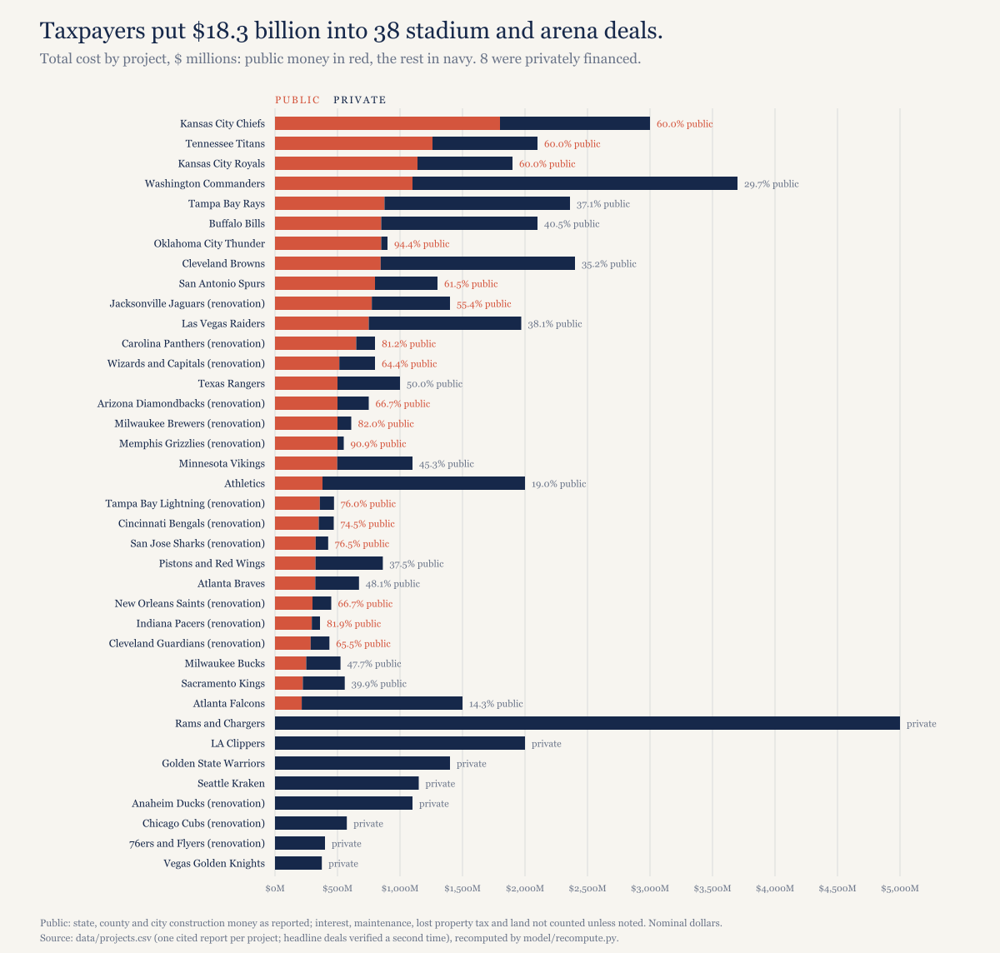
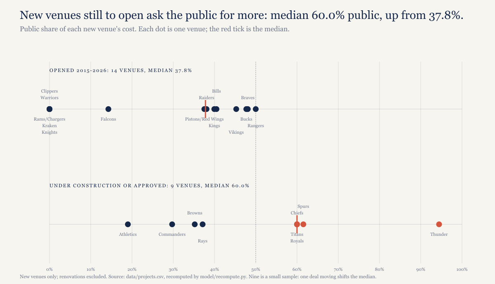
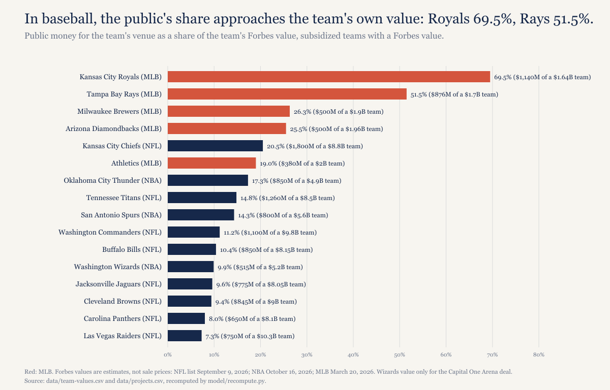
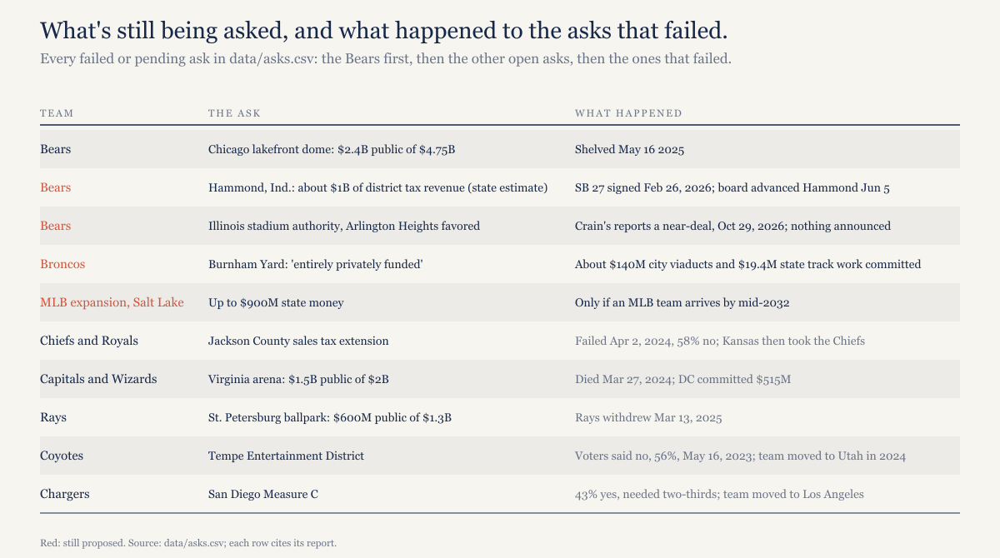

# Taxpayers have committed $13.5 billion to 19 stadiums and arenas that haven't opened yet. Voters approved about one-eighth of it.

*Across 38 recent stadium and arena deals, taxpayers put in $18.3 billion. The deals still being built ask for more of the bill, not less.*

---

## The bill

I went through 38 major-league stadium and arena projects in the United States: every one that opened from 2015 through 2026, is under construction now, or has been approved, where both a total cost and a public contribution are on the record. Together they cost $49.5 billion. State, county and city governments put in $18.3 billion of that, 37.1%.

The average hides two very different groups. Eight of the 38 were privately financed, $12.0 billion of building between them. The other 30 took public money, and among those 30 the median public share is 60.0%; 17 of them are majority public.

*[Caption: figures/captions.md, fig-01-the-bill]*

The biggest checks are recent, and most are football. Kansas is putting about $1.8 billion in STAR bonds into a $3 billion Chiefs stadium, 60% of the cost. Tennessee and Nashville are putting $1.26 billion into the Titans' new stadium, also 60%, and Kansas City and Missouri about $1.14 billion into a Royals ballpark, 60% again, though Missouri's part isn't final. Washington, D.C. committed about $1.1 billion to the Commanders, only 29.7% of a $3.7 billion project and still the fourth-largest check in the set. Then come the Rays at $876 million (37.1%), the Bills at $850 million (40.5%) and the Thunder at $850 million, which is 94.4% of their arena.

## The newest deals ask the public for more

You'd expect the public's share to be shrinking, and for a while it was. J.C. Bradbury, the Kennesaw State economist who keeps the most complete public tally of stadium costs, finds the median public share of new venues fell from about 72% in the 1990s to 47% in the 2010s and 38% in the 2020s. The dollars kept climbing anyway; his median public cost per venue reached $605 million in the 2010s, in 2024 dollars.

The deals signed since then point back up. Among the new venues in my set that opened from 2015 through 2026, the median public share is 37.8% across 14 buildings, close to Bradbury's figure for the 2020s. Among the nine new venues now under construction or approved, it's 60.0%.

*[Caption: figures/captions.md, fig-02-share-rising]*

That doesn't contradict Bradbury's decades. These nine open from 2027 to 2032, so they're the next entry in his series rather than a revision of the old ones. Nine is a small sample, and one deal moving would shift the median. But the direction shows up in the biggest deals too: the four NFL stadiums in the pipeline, for the Titans, Browns, Commanders and Chiefs, carry $5.0 billion of public money between them. Bradbury counts $5.74 billion across the six newest NFL stadiums with announced budgets.

Renovations run higher still. Most of the renovation deals approved in the last few years are majority public: the Brewers' repairs at 82.0%, the Panthers at 81.2%, the Grizzlies at 90.9%, the Sharks at 76.5%, the Lightning at 76.0% and the Bengals at 74.5%. The Pacers' renovation, which opened in 2022, was 81.9% public. A renovation gets a fraction of the attention a new stadium does, and the public's share of it is often larger.

Add up everything under construction or approved and it's 19 projects carrying $13.5 billion of public money.

## What the public number leaves out

Every public figure in this piece is construction money as reported: state, county and city dollars committed to building. It's the number politicians announce at the press conference. It isn't the full cost, and in most deals it's well short.

Interest is the first gap. Nevada's $750 million of bond principal for the Raiders' stadium becomes about $1.35 billion in total payments through 2048. Detroit's $324 million for Little Caesars Arena costs about $713 million once the bonds are paid off. KCUR estimates that Kansas City's $600 million for the Royals comes to about $1.117 billion with interest.

Property tax is the second. Most of these buildings sit on public land or belong to a public authority, so they pay little or none. Geoffrey Propheter calculated that 105 major-league venues would have owed $654.3 million more in property tax in 2022 alone, about $18 billion in present value over their current leases, and that about $7.5 billion of it would have gone to K-12 schools.

Then there's the federal government, which nobody at the press conference mentions. Tax-exempt bonds for 57 stadiums built or renovated since 2000 cost the Treasury $4.3 billion in lost revenue, according to a 2020 study in the National Tax Journal; every taxpayer in the country covers that, not just the ones in the host city. Bills to end the exemption for pro stadiums were filed in 2025 (H.R. 2434 and S. 1192), and at my last check they were still in committee.

Some deals carry operating money the headline leaves off. The Pacers' renovation shows $295 million of public capital, but the public side comes to about $800 million over 25 years once operating subsidies are counted. The Jaguars' $775 million is unusual in that it already includes $150 million for maintenance. New York's maintenance obligations for the Bills over 30 years aren't in their $850 million.

And land. The federal government is transferring the RFK site for the Commanders' campus, and no one has put a value on it. In Tampa, $180 million of state money for a college campus on the Rays' site isn't in their $876 million.

## Why it keeps happening

The short answer is that the people who decide are rarely the people who pay. Bradbury, writing in The Conversation in September, lays out the gap: elected bodies approve 96% of stadium proposals put to them, while only 58% of stadium referendums pass. Of 39 new-stadium proposals from 2005 to 2017, six went to voters.

The leagues control how many teams exist, which makes the threat to leave believable, and owners can point at recent moves. San Diego's Measure C got 43% yes in 2016 when it needed two-thirds, and the Chargers moved to Los Angeles. Tempe voters rejected the Coyotes' arena district in 2023, 56% no, and the team moved to Utah in 2024. In April 2024 Jackson County voters turned down a sales tax for the Chiefs and Royals, 58% to 42%; Kansas then committed about $1.8 billion to bring the Chiefs across the state line. When Virginia's $1.5 billion arena plan for the Capitals and Wizards died on March 27, 2024, D.C. committed $515 million to keep both teams at Capital One Arena within weeks.

The public case for these deals is economic: jobs, development, visitors who wouldn't have come. The research doesn't support it. A 2023 review in the Journal of Economic Surveys by Bradbury, Dennis Coates and Brad Humphreys covers more than 130 studies over more than 30 years and finds near-universal agreement that stadiums produce no large local economic gain. When the IGM panel of economists was asked in 2017, 24 of 34 who voted agreed that stadium subsidies likely cost taxpayers more than the local benefits, and one disagreed. Weighted by confidence, agreement was 83%.

Civic pride is a real benefit, and economists have tried to price it. Across contingent valuation studies it comes to about 13% of construction cost, which would justify a public share far below the 60.0% median above. The local accounting backs that up. Bradbury's 2022 report for Cobb County found Truist Park leaves the county about $15 million a year short.

Voters seem to have absorbed this. An Emerson poll for WGN in January 2026 found Illinois voters opposed public money for a Bears stadium 58% to 32%.

## Who votes, and the complication

Of the 38 projects, three had a public vote on the deal itself: the Rangers' Globe Life Field (about 60% yes, 2016), the Thunder's new arena (71% yes, 2023) and the Spurs' downtown arena (52% yes on Bexar County's Prop B, 2025). All three passed. Those three deals account for 11.7% of the public money in the set. Among the 19 projects still to open, the Thunder and Spurs deals are 12.2% of the public money, about one-eighth. Councils, commissions and legislatures approved the rest.

Here's what doesn't fit the easy story. The Thunder's arena is the most publicly financed building in the set, 94.4% public, about $850 million toward a cost of at least $900 million, and Oklahoma City's voters approved it with 71% of the vote. A referendum doesn't guarantee that taxpayers say no. It guarantees they get asked, which isn't the same thing, and I'd rather have the second without pretending it delivers the first.

## Who keeps the gains

Forbes publishes annual team valuations. They're estimates, not sale prices, and I use the latest list for each league: the NFL's from September 9, 2026, the NBA's from October 16, 2026 and MLB's from March 20, 2026. Set the public contribution against what each team is worth and baseball stands out.

*[Caption: figures/captions.md, fig-03-team-values]*

The public contribution to the Royals' ballpark, about $1.14 billion, is 69.5% of the $1.64 billion Forbes says the team is worth. Tampa's $876 million for the Rays is 51.5% of the team's $1.7 billion value, which is also what Patrick Zalupski's group paid for the club in 2025. The Brewers' $500 million is 26.3% of their value, the Diamondbacks' 25.5% and the Athletics' 19.0%. In football and basketball the ratios run lower because the teams are worth so much more: the Chiefs' public money is 20.5% of their value, the Thunder's 17.3% and the Titans' 14.8%.

The owners, meanwhile, have watched those values climb. Jimmy and Dee Haslam bought the Browns for $1.05 billion in 2012, and Forbes now puts them at $9.0 billion, 8.6 times the price. Terry and Kim Pegula paid $1.4 billion for the Bills in 2014; it's $8.15 billion now, 5.8 times. Shahid Khan's estimated $0.76 billion for the Jaguars in 2011 has become $8.05 billion, 10.6 times. The Thunder's owners paid $0.35 billion for the Sonics in 2006, and the Thunder are valued at $4.9 billion, 14.0 times that. Josh Harris's group paid $6.05 billion for the Commanders in 2023, and three years later Forbes has them at $9.8 billion, 1.6 times.

I can't tell you the stadiums caused those gains, and on their own they almost certainly didn't. Every NFL team in my table is valued at $8 billion or more, new stadium or not, because league-wide money lifts all of them. What I can say is who holds what when the deal is done. The owner keeps the appreciation, and the public keeps the bonds. Public money. Private stadium.

There's research on the stadium effect itself, though it's old. A 2004 study by Brown, Nagel, McEvoy and Rascher found NFL teams moving into new stadiums raised local revenue 85% and luxury-box revenue 623%, with franchise values up 35% on average. It covered seven teams with 1990s data, so read it as a direction, not a size.

The new buildings also tend to be smaller and dearer. The Bills' new stadium seats 60,108, down from 71,608. Victor Matheson of Holy Cross put it to Fortune in June: "No one has ever built a new stadium and provided more affordable tickets."

Forbes's wealth figures cut both ways. David Tepper is worth $28.5 billion and got $650 million from Charlotte for the Panthers' renovation. The Hunt family is worth $25.6 billion, a figure for the whole family rather than the Chiefs' branch, and is getting about $1.8 billion from Kansas. Against that, Steve Ballmer ($156 billion) and Stan Kroenke ($27.6 billion) built the Intuit Dome and SoFi Stadium without public construction money. And for some owners the team is most of what they have. Amy Adams Strunk is worth $2.8 billion while Forbes values her Titans at $8.5 billion; Mark Davis is worth $3.3 billion and the Raiders $10.3 billion. That's the honest version of "we can't build it ourselves." The team is worth far more than the owner could raise without selling part of it.

## The ones that paid their own way

Eight projects in the set took no public construction money: SoFi Stadium, Chase Center, the Intuit Dome, Climate Pledge Arena and T-Mobile Arena, plus renovations of the Honda Center, the Wells Fargo Center and Wrigley Field.

What they share is a very large market or a very rich owner, and usually both: Kroenke and Ballmer in Inglewood, the Warriors in San Francisco, Comcast in Philadelphia, the Samuelis in Anaheim, MGM Resorts and AEG in Las Vegas, Oak View Group in Seattle.

"Private" still covers some public help. The Intuit Dome's land came from the city of Inglewood. Critics of Chase Center point to the public transit costs around it. SoFi was built with NFL debt waivers and a $200 million league loan. The city of Seattle owns Climate Pledge Arena. Wrigley's renovation had a federal historic tax credit worth up to $75 million approved, though I couldn't verify how much was claimed. None of that is construction money on the scale of the other 30 deals, but it isn't nothing either.

Denver's pending stadium shows where the line sits. The Broncos say it will be "entirely privately funded." Denver has committed about $140 million of voter-approved bonds for viaducts, and the state spent $19.4 million moving freight tracks nearby: about $159 million of public infrastructure for a privately funded stadium.

## What's still being asked

*[Caption: figures/captions.md, fig-04-open-asks]*

The Bears are the biggest open question. Their Chicago lakefront plan, which asked for $2.4 billion of public money toward $4.75 billion, was shelved on May 16, 2025. Indiana's SB 27, signed February 26, 2026, created a stadium authority in Hammond, and state officials estimate about $1 billion of district tax revenue for it; that's an estimate, not an appropriation. Then, on October 29, Crain's Chicago Business columnist Greg Hinz reported that the Bears were nearing a deal to stay in Illinois, most likely in Arlington Heights, under a bill that would let a municipality create an authority to finance and own a stadium exempt from property taxes; lawmakers could vote as soon as November. Nothing has been announced, and no site has been picked.

In Cleveland, the state's $600 million for the Browns is blocked pending litigation, under a preliminary injunction from March 2026; I found no later ruling. Salt Lake City has up to $900 million of state money waiting for a ballpark, available only if Major League Baseball puts a team there by mid-2032. And Kansas City voters face a charter question on stadium funding on April 6, 2027, and nobody agrees yet on whether it can touch the Royals deal the council approved in October.

## What I expect

Of the projects in this set still in the pipeline, at least one public contribution grows before the building opens, through overruns, added infrastructure or a renegotiated share, and none shrinks. You can check it at each opening from 2027 to 2032.

---

## About this piece

*Construction note. The set is 38 major-league projects in the United States that opened from 2015 through 2026, are under construction, or have been approved, and that have both a total cost and a public contribution on the record. Canadian projects are left out of the dollar totals. "Public" means state, county and city construction money as reported; it doesn't include interest, maintenance, lost property tax or land unless I say so. Dollars are nominal, as reported, and not adjusted for inflation, except Bradbury's figures, which are his and in 2024 dollars. Each project's source is in data/projects.csv, and the headline deals were checked a second time against independent reporting. Team values are Forbes estimates. Every number here is recomputed from the data files by model/recompute.py. Not legal or financial advice.*

*Disclosure: I held Cubs season tickets from 1998 to 2021, and Wrigley Field's renovation is in the privately financed group. I'm also an Illinois football fan.*

## Sources

- J.C. Bradbury, [How Much Do Sports Stadiums Cost?](https://jcbradbury.com/stadium-costs/), August 5, 2026, updated August 9
- J.C. Bradbury, The Conversation, [Taxpayers don't want to pay for new NFL stadiums, so why did politicians approve billions in subsidies to fund six new ones?](https://theconversation.com/taxpayers-dont-want-to-pay-for-new-nfl-stadiums-so-why-did-politicians-approve-billions-in-subsidies-to-fund-six-new-ones-290212), September 4, 2026
- Conversable Economist (Timothy Taylor), [Professional sports and the lack of local economic payoffs](https://conversableeconomist.com/2024/01/12/professional-sports-and-the-lack-of-local-economic-payoffs/), January 12, 2024, on Bradbury, Coates and Humphreys, Journal of Economic Surveys, 2023
- Bradbury, Coates and Humphreys, Kennesaw State, [The impact of professional sports franchises and venues on local economies](https://www.kennesaw.edu/coles/centers/markets-economic-opportunity/docs/bradbury-coates-humphreys-01-30-2023.pdf), January 30, 2023
- J.C. Bradbury, Kennesaw State, [A Home Run for Cobb? The economic impact of Truist Park and The Battery Atlanta on Cobb County](https://www.kennesaw.edu/coles/centers/markets-economic-opportunity/docs/bradbury-cobb-report-march-2022.pdf), March 2022
- Kent A. Clark Center (IGM Forum), [Sports stadiums](https://kentclarkcenter.org/?p=3583), January 31, 2017
- Federal Reserve Bank of St. Louis (Scott Wolla), [The economics of subsidizing sports stadiums](https://www.stlouisfed.org/publications/page-one-economics/2017/05/01/the-economics-of-subsidizing-sports-stadiums), May 2017
- Drukker, Gayer and Gold, National Tax Journal, [Tax-exempt municipal bonds and the financing of professional sports stadiums](https://ideas.repec.org/a/ntj/journl/v73y2020i1p157-196.html), March 2020
- Field of Schemes, [Stadiums and arenas are set to collect $18B in property tax breaks over their lifetimes](https://www.fieldofschemes.com/2024/02/07/20905/stadiums-and-arenas-are-set-to-collect-18b-in-property-tax-breaks-over-their-lifetimes/), February 7, 2024, on Geoffrey Propheter, Major League Sports and the Property Tax (2022)
- Congress.gov, [H.R. 2434, No Tax Subsidies for Stadiums Act](https://www.congress.gov/119/bills/hr2434/BILLS-119hr2434ih.htm), 2025
- Brown, Nagel, McEvoy and Rascher, Sport Marketing Quarterly, [Revenue and wealth maximization in the National Football League: the impact of stadia](https://mpra.ub.uni-muenchen.de/25741), 2004
- Fortune, [American taxpayers spent $33 billion on sports stadiums, and fans got fewer seats and higher prices](https://fortune.com/2026/06/11/american-taxpayers-spent-33-billion-sports-stadiums-fewer-seats-higher-prices/), June 11, 2026
- Fox 32 Chicago, [Bears stadium funding poll](https://www.fox32chicago.com/news/bears-stadium-funding-poll), January 2026, on the Emerson College/WGN poll
- Forbes (Justin Teitelbaum), [The NFL's most valuable teams 2026](https://www.forbes.com/sites/justinteitelbaum/2026/09/09/the-nfls-most-valuable-teams-2026/), September 9, 2026
- Forbes (Justin Teitelbaum), [The most valuable NBA teams 2026](https://www.forbes.com/sites/justinteitelbaum/2026/10/16/the-most-valuable-nba-teams-2026/), October 16, 2026
- Forbes (Justin Teitelbaum), [Baseball's most valuable teams 2026](https://www.forbes.com/sites/justinteitelbaum/2026/03/20/baseballs-most-valuable-teams-2026/), March 20, 2026
- Forbes (Brett Knight), [America's richest sports team owners 2026](https://www.forbes.com/sites/brettknight/2026/09/14/americas-richest-sports-team-owners-2026/), September 14, 2026
- Forbes profiles, read October 28, 2026: [David Tepper](https://www.forbes.com/profile/david-tepper/), [Stan Kroenke](https://www.forbes.com/profile/stanley-kroenke/), [Amy Adams Strunk](https://www.forbes.com/profile/amy-adams-strunk/), [Mark Davis](https://www.forbes.com/profile/mark-davis-1/), [Terrence Pegula](https://www.forbes.com/profile/terrence-pegula/)
- NFL.com, [Sale of Cleveland Browns to Jimmy Haslam finalized](https://nfl.com/news/sale-of-cleveland-browns-to-jimmy-haslam-finalized-0ap1000000085361), 2012
- NFL.com, [Pakistani-born Khan approved as Jaguars' new owner](https://nfl.com/_amp/pakistani-born-khan-approved-as-jaguars-new-owner-09000d5d8250c180), 2011
- Sportico, [NFL owners approve Washington Commanders sale](https://www.sportico.com/leagues/football/2023/washington-commanders-sale-nfl-owners-approve-1234731488/), 2023
- Sportico, [Chiefs' Kansas stadium: cost and public money](https://www.sportico.com/business/real-estate/2025/chiefs-kansas-stadium-cost-public-money-1234879708/), December 2025
- NewsChannel 5 Nashville, [In a historic vote, Metro Council decides to fund the new Titans stadium](https://www.newschannel5.com/news/in-a-historic-vote-metro-council-decides-to-fund-the-new-titans-stadium), April 26, 2023
- KCUR, [Kansas City will tap 30 years of tax growth to repay Royals stadium construction](https://www.kcur.org/politics-elections-and-government/2026-10-08/kansas-city-will-tap-30-years-of-tax-growth-to-repay-royals-stadium-construction), October 8, 2026
- AP via WSLS, [DC Council gives final approval to the Washington Commanders' return to the RFK Stadium site](https://www.wsls.com/sports/2025/09/17/dc-council-gives-final-approval-to-the-washington-commanders-return-to-the-rfk-stadium-site/), September 17, 2025
- Axios Tampa Bay, [Hillsborough approves stadium deal for the Rays](https://www.axios.com/local/tampa-bay/2026/08/28/hillsborough-approves-stadium-deal-rays-tampa-future), August 28, 2026
- AP via WTOP, [Bills owner Terry Pegula helps open team's new $2.1 billion stadium](https://wtop.com/nfl/2026/06/bills-owner-terry-pegula-helps-open-teams-new-2-1-billion-stadium/), June 23, 2026
- StadiumDB, [Highmark Stadium](https://stadiumdb.com/stadiums/usa/highmark_stadium)
- AP via News4Jax, [Oklahoma City voters approve sales tax for $900 million arena to keep NBA's Thunder through 2050](https://www.news4jax.com/sports/2023/12/13/oklahoma-city-voters-approve-sales-tax-for-900-million-arena-to-keep-nbas-thunder-through-2050/), December 13, 2023
- NFL.com, [Browns break ground on domed stadium in Brook Park](https://www.nfl.com/news/browns-break-ground-2-billion-domed-stadium-brook-park-2029), April 30, 2026
- Texas Public Radio, [Here's what's in the downtown arena term sheet the city just inked with the San Antonio Spurs](https://www.tpr.org/government-politics/2025-08-21/heres-whats-in-the-downtown-arena-term-sheet-the-city-just-inked-with-the-san-antonio-spurs), August 21, 2025
- Action News Jax, [Jaguars stadium renovations deal: what we know about cost and what will be built](https://www.actionnewsjax.com/news/local/jaguars-stadium-renovations-deal-heres-what-we-know-about-cost-what-will-be-built/FM22E7ANMNFPBOGUQWARM6Y3A4/), June 2024
- LVSportsBiz, [Las Vegas, Clark County: what's left to pay off on the Raiders stadium debt, principal and interest](https://lvsportsbiz.com/2024/05/17/congrats-las-vegas-clark-county-youre-only-1178161041-from-paying-off-your-raiders-stadium-debt-remember-its-principal-and-interest/), May 17, 2024
- The Bond Buyer, [Little Caesars Arena: how the cost nearly doubled](https://www.bondbuyer.com/articles/little-caesars-arena-how-the-cost-nearly-doubled-to-863-million)
- Inside Indiana Business, [Long-term deal secures Pacers, brings upgrades to Fieldhouse](https://www.insideindianabusiness.com/articles/long-term-deal-secures-pacers-brings-upgrades-to-fieldhouse), April 2019
- PBS Wisconsin, [Evers signs $500 million plan to fund repairs and upgrades at Brewers stadium](https://pbswisconsin.org/news-item/evers-signs-500-million-plan-to-fund-repairs-upgrades-at-brewers-stadium/), December 5, 2023
- Athletic Business, [Charlotte City Council approves Bank of America Stadium renovation funding](https://www.athleticbusiness.com/facilities/stadium-arena/article/15678321/), June 25, 2024
- Yahoo Sports, [FedExForum documents offer strong clue](https://sports.yahoo.com/articles/fedexforum-documents-offer-strong-clue-194527628.html), October 13, 2026
- Hillsborough County, [Board of County Commissioners meeting recap for January 21, 2026](https://hcfl.gov/newsroom/2026/01/23/board-of-county-commissioners-meeting-recap-for-jan-21-2026), January 23, 2026
- KTVU, [San Jose Sharks and SAP Center commit to 25-year stay](https://www.ktvu.com/sports/san-jose-sharks-sap-center-commit-25-year-stay), August 2025
- WCPO, [Paycor Stadium renovation plan approved by Hamilton County](https://www.wcpo.com/sports/football/bengals/paycor-stadium-renovation-plan-approved-by-hamilton-county), July 31, 2025
- ABC15, [Arizona governor approves up to $500M in taxpayer funds to upgrade home of Diamondbacks](https://www.abc15.com/news/local-news/arizona-governor-approves-up-to-500m-in-taxpayer-funds-to-upgrade-home-of-diamondbacks), June 27, 2025
- AP via CBS News, [Athletics' Las Vegas stadium on track for 2028 opening, officials say](https://www.cbsnews.com/sanfrancisco/news/athletics-las-vegas-stadium-on-track-for-2028-opening-officials-say/), December 5, 2025
- Ballpark Digest, [Voters overwhelmingly approve new Rangers ballpark funding](https://ballparkdigest.com/2016/11/09/voters-overwhelmingly-approve-new-rangers-ballpark-funding/), November 9, 2016
- Ideastream, [Cleveland Guardians lease extension passes City Council](https://www.ideastream.org/news/cleveland-guardians-lease-extension-passes-city-council), November 2021
- Minnesota Sports Facilities Authority, [U.S. Bank Stadium use agreement summary](https://www.msfa.com/df-data/files/USE%20AGREEMENT/DAUA%20agreement%20summary%20final.pdf)
- StadiumDB, [Is Atlanta's Mercedes-Benz Stadium avoiding $700 million in tax?](https://stadiumdb.com/news/2019/01/atlanta_is_mercedesbenz_stadium_avoiding_700_million_in_tax), January 2019
- The Bond Buyer, [Louisiana Bond Commission OKs deal to upgrade Superdome](https://bondbuyer.com/news/louisiana-bond-commission-oks-deal-to-upgrade-superdome), August 2019
- Arena Digest, [Cost of Golden 1 Center increases](https://arenadigest.com/2016/09/01/cost-of-golden-1-center-increase/), September 1, 2016
- PolitiFact, [Will Wisconsin taxpayers get a tremendous payback on the Milwaukee Bucks arena?](https://api.politifact.com/factchecks/2019/may/22/scott-neitzel/will-wisconsin-taxpayers-get-tremendous-payback-mo/), May 22, 2019
- Commercial Observer, [DC bill on Capital One Arena](https://commercialobserver.com/2024/10/dc-bill-capital-one-arena-88m/), October 21, 2024
- Guinness World Records, [Most expensive sports stadium](https://www.guinnessworldrecords.com/world-records/635609-most-expensive-sports-stadium)
- Wikipedia, [Chase Center](https://en.wikipedia.org/wiki/Chase_Center) and [Intuit Dome](https://en.wikipedia.org/wiki/Intuit_Dome)
- Arena Digest, [Climate Pledge Arena cost now $1.15B](https://arenadigest.com/2021/05/11/climate-pledge-arena-cost-now-1-15b/), May 11, 2021
- CNBC, [A $375 million Vegas project with no slot machines](https://www.cnbc.com/2016/04/06/a-375-million-vegas-project-with-no-slot-machines.html), April 6, 2016
- Front Office Sports, [Comcast's $400 million Wells Fargo Center upgrades near completion](https://frontofficesports.com/article/comcasts-400-million-wells-fargo-center-upgrades-near-completion/)
- Orange County Business Journal, [Honda Center set for $1.1B overhaul](https://www.ocbj.com/tourism/honda-center-set-for-1-1b-overhaul/)
- WTTW, [Wrigley plan approved for federal tax credit](https://news.wttw.com/2014/12/04/wrigley-plan-approved-federal-tax-credit), December 4, 2014
- KCTV5, [Sales tax to fund stadium construction for Royals, Chiefs fails in Jackson County](https://www.kctv5.com/2024/04/03/sales-tax-fund-stadium-construction-royals-chiefs-fails-jackson-county), April 3, 2024
- Commercial Observer, [Capitals and Wizards arena in Alexandria is officially dead](https://commercialobserver.com/2024/03/capitals-and-wizards-arena-in-alexandria-is-officially-dead), March 2024
- Cronkite News, [Arizona Coyotes arena: Tempe Entertainment District propositions](https://cronkitenews.azpbs.org/2023/05/17/arizona-coyotes-arena-tempe-entertainment-district-propositions-tempe-election/), May 17, 2023
- League of Fans, [San Diego citizens tell Chargers to take a hike](https://www.leagueoffans.org/2016/11/28/san-diego-citizens-tell-chargers-to-take-a-hike-but-arlington-voters-cave-in-to-rangers-demands/), November 28, 2016
- WTTW, [Chicago Bears call double reverse on domed lakefront stadium](https://news.wttw.com/2025/05/16/chicago-bears-call-double-reverse-telling-mayor-plan-new-domed-lakefront-stadium-ice), May 16, 2025
- Axios Chicago, [Pritzker on the Bears stadium](https://www.axios.com/local/chicago/2026/10/14/pritzker-bears-stadium-chicago-site-nfl-goodell-ryan-bailey-indiana), October 14, 2026
- Patch, [Bears near Illinois stadium deal, Arlington Heights favored: report](https://patch.com/illinois/chicago/bears-near-illinois-stadium-deal-arlington-heights-favored-report), October 29, 2026, on Greg Hinz's report in Crain's Chicago Business
- Indiana Capital Chronicle, [Indiana lawmakers give final OK to plan trying to lure Bears stadium](https://indianacapitalchronicle.com/2026/02/26/indiana-lawmakers-give-final-ok-to-plan-trying-to-lure-bears-stadium/), February 26, 2026
- WYSU, [Another ruling blocks Ohio's transfer of unclaimed money for sports facilities fund](https://wysu.org/ohio-news/2026-03-09/another-ruling-blocks-ohios-transfer-of-unclaimed-money-for-sports-facilities-fund), March 9, 2026
- Denverite, [Denver Broncos and the Burnham Yard purchase](https://denverite.com/2026/03/20/denver-broncos-burnham-yard-purchase/), March 20, 2026
- KSL, [Utah Legislature approves milestone bill creating Fairpark district, MLB stadium framework](https://www.ksl.com/article/50933256/utah-legislature-approves-milestone-bill-creating-fairpark-district-mlb-stadium-framework), 2024
- ENR, [Tampa Bay Rays withdraw from $1.3B ballpark plan](https://www.enr.com/articles/60458-tampa-bay-rays-withdraw-from-13b-ballpark-plan), March 2025
- Data and checking script: [stadium-subsidies-2026 on GitHub](https://github.com/mgag70-prog/hqsports-research/tree/main/stadium-subsidies-2026)

---

## Not for publication

Alternate titles:

1. The public pays for the building. The owner keeps the team, and the team is worth more.
2. 38 stadiums and arenas, $18.3 billion of public money, three public votes.

Cover line (verbatim in "Who keeps the gains"): Public money. Private stadium.

Open items:

- Source titles in the Sources list for several local outlets were written from the article URLs and the research files, not copied from each page; check the exact headline before publishing.
- The outline had Portland's up to $800 million in bonds for an expansion ballpark. It's only in data/research/mlb-agent.csv, not in the files this draft draws on, so it's left out.
- The outline also mentioned the Commanders' exclusive development rights, the Royals' private ballpark village and the Braves' Battery as development owners keep. Those are in the research notes only (evidence-check.md, mlb-agent.csv), so the draft doesn't make the claim.
- The 42% in the Jackson County vote is computed from the vote count in data/asks.csv (56,606 yes of 134,958), 41.9%, not a reported percentage.
- Royals: Missouri's share (about $540 million implied) isn't final; the draft says so.
- The referendum statistics are credited to Bradbury's Conversation article only, because the studies his links point to don't match the claims (verification.md, item 23).
- Kansas City's April 6, 2027 charter question: the research files say its effect on the Royals deal is disputed.

RECHECK before publishing:

- H.R. 2434 / S. 1192: status on congress.gov.
- Browns: any ruling on the preliminary injunction since July 2026.
- Bears: status on the day of publication (last checked October 31, 2026: Crain's report of a near-deal in Illinois, nothing announced).
